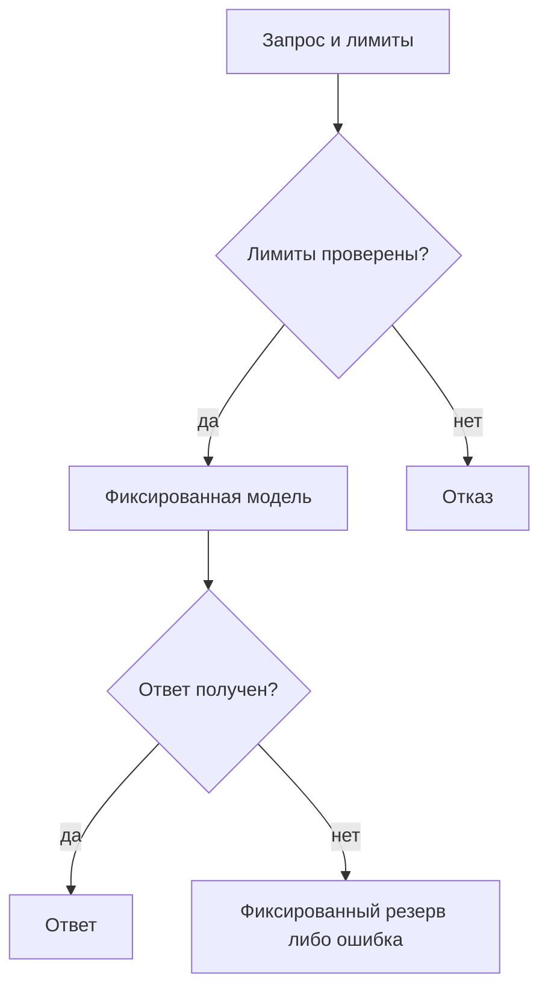
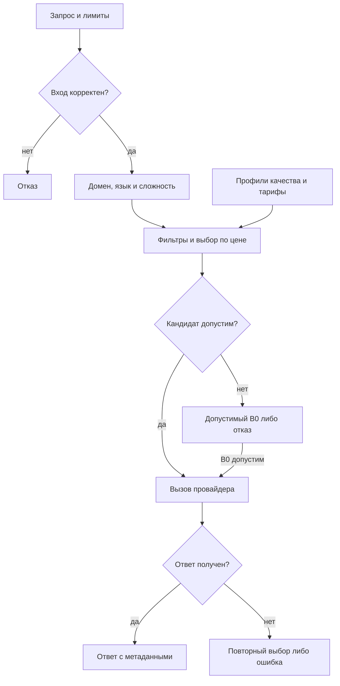

# Дизайн ML-системы Smart LLM Router. MVP

Лазарчик Михаил Павлович, ИТМО. ДЗ №2, редакция от 21.11.2026.

В ДЗ №2 исследованы три открытых набора заданий и спроектирован эксперимент для сравнения стратегий маршрутизации. Результаты анализа описаны в [отчёте EDA](../reports/eda.md). Пороги приёмки ниже предложены для будущего MVP. Структура документа опирается на [шаблон Reliable ML](https://github.com/IrinaGoloshchapova/ml_system_design_doc_ru/blob/main/ML_System_Design_Doc_Template.md).

## 1. Цели и предпосылки

### 1.1 Зачем идём в разработку продукта?

Дать разработчикам единый интерфейс для готовых языковых моделей разных ценовых уровней. Маршрутизатор оценивает запрос по домену, языку и наблюдаемым признакам сложности, затем выбирает модель с учётом качества, стоимости и времени ожидания. Цель эксперимента — снизить полную стоимость обработки как минимум на 30% при допустимой потере качества до 2 п.п. и сохранении скорости ответа.

### 1.2 Бизнес-требования и ограничения

| Параметр | MVP |
| --- | --- |
| Задачи | Общие текстовые запросы, математика и генерация Python на русском и английском |
| Вход | Текст, необязательный домен, допустимые провайдеры, бюджет, дедлайн и максимальный размер ответа |
| Лимиты | До 4 096 токенов пользовательского текста по общему токенизатору, до 512 токенов ответа по счётчику модели, до 30 секунд на запрос и до двух попыток |
| Выход | Ответ, модель и провайдер, причина выбора, задержка и известная или расчётная стоимость попыток. При сбое возвращается статус |
| Режимы | Локальная обработка и смешанный режим. В смешанном режиме внешние вызовы возможны только у разрешённых провайдеров |
| Пилот | Одинаковые несекретные запросы для всех стратегий, измерения полной стоимости и задержки, проверка приемлемости ответа |

### 1.3 Границы проекта и итерации

MVP обрабатывает одиночные текстовые запросы и использует готовые LLM. Реестр моделей, профили и результаты экспериментов хранятся в файлах. Версии данных, шаблоны запроса, конфигурации моделей, тарифы и условия запуска фиксируются перед сравнением. Масштабирование относится к следующей итерации.

### 1.4 Предпосылки решения

Для каждого домена нужен собственный пул кандидатов. Предварительный отбор опирается на публичные сравнения, а сам маршрут — на измерения на одинаковых заданиях с учётом полной стоимости запроса.

| Домен | Кандидаты и основание для отбора |
| --- | --- |
| Генерация Python | MiMo-V2.6-Flash → Qwen4 Max → GPT-6.1 Terra → Gemini 4 Hydrogen → Claude Fable 5.2. Это выбранные точки общего фронтира по цене выходного токена и Intelligence Index. Качество генерации Python проверим отдельными тестами. [CheapestInference](https://www.cheapestinference.com/reports/llm-pareto-frontier/) |
| Короткие литературные тексты на русском | GLM-5.3-Flash → DeepSeek-V4.1-Flash → Gemini 4 Hydrogen → Gemini 4 Neon. Карточки русскоязычной Text Arena помогают отобрать кандидатов. Собственная рубрика должна проверить связность, жанр и соблюдение инструкции. [GLM](https://arena.ai/leaderboard/chat/text/russian/models/glm-5.3-flash-hkpj), [DeepSeek](https://arena.ai/leaderboard/chat/text/russian/models/deepseek-v4.1-flash-20260910-max-eqym), [Hydrogen](https://arena.ai/leaderboard/chat/text/russian/models/gemini-4-hydrogen-high-wwg2), [Neon](https://arena.ai/leaderboard/chat/text/russian/models/gemini-4-neon-high-m0ck) |
| Локальный режим | Qwen3-4B-Instruct-2507. Возможность запуска и качество проверяются на доступном оборудовании. [Карточка модели](https://huggingface.co/Qwen/Qwen3-4B-Instruct-2507) |

Первый эксперимент ограничен тремя кандидатами, чтобы оценить бюджет каждого этапа. Предлагаемый состав — локальная Qwen3-4B-Instruct-2507 и облачные MiMo-V2.6-Flash и GPT-6.1 Terra при подтверждении доступа. Версии, провайдеры, квантование, оборудование и тарифы закрепляются до прогона. Этот набор прогоняется во всех шести группах, включая математику и английские общие запросы. Дополнение пула новыми кандидатами требует следующего цикла измерений.

## 2. Методология

### 2.1 Постановка задачи

Решение принимается по каждому запросу. Кандидат — конкретная модель у конкретного провайдера с фиксированной конфигурацией. Профиль качества пересчитывается при смене версии модели, шаблона, квантования или оборудования. Тарифы, доступность и ресурсные оценки обновляются перед экспериментом и при изменениях у провайдера.

| Стратегия | Правило |
| --- | --- |
| B0. Фиксированная модель | Одна основная модель в каждом режиме. При наличии второго допустимого кандидата закрепляется резерв |
| B1. Минимальная цена | Самый дешёвый кандидат, который укладывается в ограничения запроса |
| MVP. Маршрутизация | Самый дешёвый кандидат среди вариантов, прошедших ограничение по ресурсам и проверку качества для текущей группы запросов |

### 2.2 Блок-схема решения

Для B0, B1 и MVP действуют одни ресурсные проверки. Правила подстановки фиксированной модели и резервного вызова описаны в этапах 4 и 5.

### 2.3 Этапы решения задачи

#### Этап 1. Подготовка данных

| Источник | Данные и формат | Вывод для проекта |
| --- | --- | --- |
| MGSM | 500 строк TSV, 250 задач в двух языках | В 8 строках корректные разделители тысяч. Отдельно отмечены 32 пары, в которых один или оба варианта переработаны в MGSM-Rev2 |
| Belebele | 1 800 строк JSONL, 900 вопросов в двух языках | Вопросы к одному тексту зависимы. У четырёх заданий повторяются варианты ответа, в двух случаях продублирован правильный вариант. Набор проверяет понимание текста |
| HumanEval | 164 задания Python на английском в JSONL.gz | Эталонную функцию и структуру тестов проверили статически. Нужны новые задачи на русском и отдельная среда для проверки сгенерированного кода |

Однократный сбор воспроизводится из [закреплённых источников](../data/sources.lock.json). Загрузчик сверяет размер и SHA-256, EDA проверяет обязательные поля, ключи, эталоны и связи между заданиями. Пять языковых файлов содержат 2 464 строки, 1 150 пар переводов и 902 группы связанных заданий. При каждом обновлении источника сохраняются его ревизия и отдельный отчёт. Данные и условия использования описаны в [паспорте источников](../data/README.md).

В MGSM пара определяется номером строки, в Belebele — ссылкой на текст и номером вопроса. В одну группу входят переводы, все вопросы к общему тексту и нормализованные дубликаты. Четыре задания с повторяющимися вариантами исключаются из очищенной диагностической оценки. Для MGSM отдельно проверим чувствительность результата к исключению 32 затронутых пар или переходу на закреплённую исправленную версию. Длины условий измерены общим диагностическим токенизатором. Для расчёта цены и проверки контекста нужны счётчики конкретных моделей.

**Признаки и входные параметры**

| Сущность и ключ | Поля | Доступность и кто готовит | Проверка качества |
| --- | --- | --- | --- |
| Задание, `task_id` | Пользовательский текст | Публичные условия доступны. Новый корпус готовят авторы задач | В EDA проверены полнота и уникальность. Новые условия проверяет куратор |
| Связь, `group_id` | Оригинал, переводы, общий текст и семейство шаблона | Публичные группы собраны. Связи новых задач размечает куратор до разбиения | Проверка переводов, общих текстов и дублей описана в EDA |
| Сценарий, `scenario_id` | Бюджет, дедлайн, лимит ответа, режим, допустимые провайдеры и необязательный домен | Спецификацию сценария готовит автор эксперимента | Интеграционные проверки на этапе 5 |
| Признаки для маршрута | Распознанный домен и язык, длина, признаки кода и сложности, счётчики входа по кандидатам | Диагностические длины посчитаны. Остальные признаки рассчитывает маршрутизатор | Признаки распознавания и их вклад проверяются на этапе 2 |

**Цели и результаты**

| Сущность и ключ | Поля | Доступность и кто готовит | Проверка качества |
| --- | --- | --- | --- |
| Эталон задания, `task_id` | Проверенные домен, язык, числовой ответ, рубрика или скрытые тесты | Есть эталоны трёх публичных наборов. Новые готовят авторы задач и проверяющие | В EDA проверены форматы эталонов и их согласованность в парах |
| Ответ модели, `task_id × scenario_id × endpoint_id × prompt_hash × repeat` | Ответ, приемлемость, версия рубрики, статус оценки, время, токены и стоимость | Матрицу разработки соберут адаптеры провайдеров и асессоры | Полнота наблюдений и согласованность оценок на этапе 3 |
| Итог запроса, `task_id × scenario_id × strategy_id × run_id` | Финальный ответ или ошибка, результаты обеих попыток, расход и полная задержка | Результаты закрытого теста соберут сервис и асессоры | Парное сравнение стратегий в разделе 3 |

Эталоны, название набора и исходы будущих вызовов доступны контуру оценки. Маршрутизатор получает пользовательский текст и параметры сценария. Пропуск в матрице измерений хранится отдельным статусом. Реально случившаяся ошибка вызова получает оценку 0.

**Дополнительный сбор.** Публичные наборы покрывают пять групп из шести, содержат преимущественно короткие учебные задачи и могут быть знакомы моделям по предобучению. Для разработки сначала нужны 200 новых заданий на группу, включая русский Python и свободные общие ответы на обоих языках. Авторы составляют условия, проверяют оба языка у переводов, а для Python готовят скрытые тесты. Для итогового сравнения рабочая оценка — ещё 1 000 заданий на группу. Это 1 200 заданий для настройки и 6 000 для закрытой проверки. Для проверки контекста и сложности добавляются длинные задания и задачи с несколькими требованиями. Размер частей уточняется по числу независимых семейств и расхождениям стратегий на калибровочном прогоне.

**Конфиденциальность.** В публичных текстах встречаются имена и ссылки. Для новых запросов нужны разрешение на использование, проверка и маскирование секретов и персональных данных. Передача внешнему провайдеру разрешается отдельно. Рабочие тексты хранятся в контуре эксперимента с ограниченным доступом, эксплуатационные журналы содержат только технические поля. Для пилотных частных текстов предлагается 30-дневный срок хранения с удалением после его истечения.

**Результат.** Общий каталог условий, сценариев и связанных групп, отдельные таблицы признаков и целей, паспорт источников и отчёт качества. Для B0 и B1 достаточно данных о кандидатах и ограничениях запроса. MVP дополнительно использует признаки текста и парные оценки кандидатов для профилей. До итоговой проверки куратор подтверждает покрытие шести групп, уникальность ключей и отсутствие пересечений связанных задач между частями.

#### Этап 2. Подготовка прогнозных моделей

**Целевая переменная.** В матрице разработки `y_attempt(x, e)` оценивает один вызов кандидата `e`. В итоговом тесте `y_final(x, π)` оценивает конечный ответ стратегии `π` после обработки запроса `x`. Метка равна 1 для приемлемого ответа и 0 при неприемлемом ответе, технической ошибке или отказе. Потеря отдельного ответа равна `1 − y`. Основная метрика `Q` — среднее шести долей приемлемых ответов с равными весами. Цель пилота — минимизировать полную стоимость при `Q(B0) − Q(π) ≤ 0,02` и соблюдении требований к скорости и надёжности.

**Валидация.** Куратор проверяет близкие дубли и семейства шаблонов во всём новом корпусе до заморозки частей, включая связи между будущей разработкой и тестом. Разработчик получает только часть разработки. Её делим по группам примерно 60/40 на построение профилей (`profile`) и настройку (`validation`) с сохранением доменов и языков. Открытые наборы образуют внешний диагностический контур. Belebele используется в роли тестового набора, предусмотренной авторами. [Назначение набора](https://github.com/facebookresearch/belebele#training-set)

**Подготовка бейзлайнов.** Для обеих стратегий проверяем обязательные поля и размеры запроса. При сборке входа приводим окончания строк к одному виду и сохраняем исходные условия и отступы кода. На `validation` для B0 выбираем доступного кандидата с наибольшим `Q` по матрице ответов во всех шести группах. При равенстве выбираем меньшую полную стоимость, затем стабильный `endpoint_id`. Для локального режима выбор ограничиваем локальными моделями. Резервный вариант фиксируется из оставшихся допустимых кандидатов по тому же правилу. B1 ранжирует пригодные варианты по оценке цены без использования профилей качества. Все стратегии получают один пользовательский текст и одинаковую системную инструкцию. Шаблон зависит от открытых полей запроса и версии адаптера. Истинный домен и язык используются для оценки.

**Подготовка MVP.** Если клиент указал поддерживаемый домен, используем его. Иначе признаки Python включают конструкции кода и просьбы написать или исправить программу, а признаки математики — формулы и характерные инструкции к вычислению. При двух сильных сигналах ставим `unknown`. Общие текстовые запросы образуют третью категорию. Язык берём из явной инструкции, иначе ориентируемся на долю кириллических или латинских букв вне кода. Если ни одна доля не достигает 80% либо букв нет, язык помечается как неизвестный. Все словари и правила фиксируем до теста.

Признак сложности срабатывает при длине от 1 024 токенов по общему токенизатору или при двух и более явно перечисленных требованиях к ответу. В первом сравнении профили строятся по распознанным домену и языку. При делении по сложности для каждой новой группы действует тот же минимум наблюдений, что у общего профиля. Публичный EDA не даёт меток сложности. Проверяем вклад признака на новых заданиях сравнением вариантов политики.

**Допуск по качеству.** Для текущей группы используем пары измерений B0 и кандидата на одних заданиях в `profile`. Для каждого задания считаем `d = y_attempt(x, B0) − y_attempt(x, кандидат)`.

1. Есть парные измерения хотя бы в 100 группах `group_id`. Из 200 заданий на доменно-языковой срез в `profile` попадёт примерно 120. Стартового сбора хватает только на недроблёный профиль при достаточной независимости. Нехватку компенсируем добором семейств.
2. Односторонняя 95% верхняя граница средней потери `d` по групповому бутстрэпу не выше выбранного допуска `margin`. Группы перевода пересэмплируются целиком. При менее чем десяти группах с расхождениями профиль помечается как недостаточный для такой оценки и остаётся в диагностике.
3. Для простых запросов при нехватке профильной подгруппы используется общий профиль домена и языка. Для сложных запросов в варианте политики с учётом сложности требуется профиль сложных заданий. При его отсутствии применяется правило B0 из этапа 4.

На `validation` перебираем допуски `0,00 / 0,02 / 0,05` и сравниваем профили с признаком сложности и без него. По матрице одиночных вызовов предварительно выбираем вариант с минимальной расчётной стоимостью при точечной потере до 2 п.п. в среднем и до 5 п.п. в каждой группе. На небольшой части разработки проверяем ограничения, время и технические исходы выбранного варианта. Если ни одна политика не проходит условия настройки, эталонной остаётся B0. Правила замораживаются до открытия теста. Решение по критериям пилота принимается по живому прогону.

**Метрики и разбор ошибок.** Сравниваем долю приемлемых ответов, `Q` и разницы по каждой группе. Для распознавания домена считаем macro-F1, точность и долю `unknown`. На `validation` сопоставляем автоматический домен с явно переданным, отключаем признаки языка и сложности по очереди, разбираем проигрыши B0 по причинам. В журнале решения сохраняются группа, размер профиля, оценка потери, исключённые кандидаты и причина выбора. Риск запоминания публичных задач ограничивает применение внешних результатов. Риск подгонки порогов снижают короткий перечень вариантов и одно сравнение на закрытом тесте. Если правила определения домена дают много ошибок, следующий кандидат — TF-IDF с логистической регрессией и кросс-энтропией на размеченной части разработки.

**Результат.** Зафиксированные B0, B1 и MVP, части корпуса, конфигурации генерации, профили и протокол сравнения. Подготовка правил относится к ДЗ №2, матрица реальных ответов появляется на этапе 3.

#### Этап 3. Сопоставимые ответы и их оценка

На части разработки запускаем каждого кандидата на одних заданиях. Сохраняем один ответ на конфигурацию, время, статусы, токены и расходы. Прогрев отделяем от измерений, порядок вызовов перемешиваем с фиксированным seed. Параметры генерации закрепляем для каждого кандидата. Повтор на части разработки позволяет оценить нестабильность.

**Бейзлайны.** По общей матрице выбираем кандидатов для B0 и получаем оценки цены для B1. **MVP.** По той же матрице строим профили и разбираем случаи, когда маршрутизатор уступил B0. Итоговый тест проходит через сервис и оценивает фактические ответы всех трёх стратегий с учётом резервных вызовов.

| Тип задания | Критерий проверки |
| --- | --- |
| Публичная математика | Конечное число сравнивается с эталоном после разбора по формату задачи. Некорректный формат фиксируется отдельным статусом |
| Публичное понимание текста | Один индекс 1–4 сравнивается с эталоном. Результаты Belebele публикуются для исходного и очищенного наборов |
| Python | Код сохраняет сигнатуру и проходит скрытые тесты в изолированной среде. Сбой среды записывается отдельным статусом |
| Новые общие тексты | Правильность, выполненные требования, язык. Для открытых заданий дополнительно проверяются жанр и связность |
| Новая математика и Python | Результат совпадает с проверенным эталоном или проходит тесты. Объяснения и язык оцениваются в случаях, где их требует задание |

В сравнении моделей два асессора независимо оценивают каждый полученный ответ по общей рубрике. Оба видят задание и материалы проверки. Модель, стратегия и вторая оценка скрыты. Приемлемым считается ответ с двумя положительными оценками, прошедший обязательные автоматические проверки формата и тестов. Если в задании просят дату и причину события, ответ с одной датой получает 0. Доля расхождений публикуется. Технический отказ или таймаут получает 0 автоматически. При сбое оценщика повторно проверяем сохранённый ответ. До восстановления оценки наблюдение считается пропущенным. Автоматические показатели публикуются отдельно для публичных наборов.

**Результат.** Матрица разработки, версии условий генерации, журнал разметки и воспроизводимый расчёт метрик. Эталонные решения и тесты Python доступны только контуру оценки. Перед оценкой сгенерированного кода проверяется изоляция среды без сети и секретов, с ограничениями времени, памяти и процессов.

#### Этап 4. Выбор маршрута и экономика

Перед каждой попыткой проверяем доступность провайдера, разрешения сценария, контекст, остаток бюджета и времени. Лимит пользовательского текста считаем токенизатором Qwen3-4B-Instruct-2507 ревизии `cdbee75f17c01a7cc42f958dc650907174af0554`. Адаптер отдельно проверяет полностью оформленный вход и резерв на генерацию по счётчику выбранной модели. Максимальная стоимость включает платные категории, в том числе токены рассуждения, если они тарифицируются, и локальный норматив вычислений. Кандидат допускается только при определимой верхней границе расходов и контекста. Для предварительной проверки времени сравниваем оставшееся время с измеренным p95 вызова у кандидата. Таймаут адаптера ограничивает время ожидания ответа независимо от профильной оценки.

**Бейзлайны.** B0 проверяет пригодность фиксированной модели. B1 выбирает допустимого кандидата с наименьшей ожидаемой ценой первой попытки. Для API цена складывается из оценки входных, выходных и иных платных токенов. Для локальной модели используется ожидаемое вычислительное время и стоимость единицы ресурса. При равенстве цены выбираем меньший профильный p95, затем стабильный ID.

**MVP.** Применяем фильтр качества этапа 2, после чего используем тот же порядок по цене. Модель B0 проходит фильтр качества как точка сравнения. Полная стоимость каждой стратегии измеряется на всех попытках с учётом работы сервиса.

При неизвестном домене или языке либо отсутствии допущенных альтернатив MVP передаёт запрос стратегии B0 для данного режима. Отдельный кандидат с недостающим профилем исключается из выбора. У B0 сохраняются ресурсные проверки и правило закреплённого резерва. Если основная модель B0 недопустима, сервис возвращает `no_feasible_model`. Такие запросы отражаются в отчёте отдельной причиной маршрута и оцениваются по фактическому исходу.

**Результат.** Реестр тарифов и конфигураций, таблица качества, стоимости и задержки по моделям, журнал причин решения и верхняя оценка бюджета эксперимента.

#### Этап 5. Инференс и резервный вызов

Адаптер возвращает статус, фактические токены, время и списание по попытке. Единый монотонный таймер ограничивает всю обработку от приёма запроса до ответа клиенту. Таймаут адаптера использует оставшееся время. После технического сбоя разрешена одна попытка с другим допустимым кандидатом. Если резерва нет, возвращается исходный статус ошибки. Если первый вызов мог повлечь списание, его резерв сохраняется до уточнения. Локальный режим действует для обеих попыток. При истечении дедлайна клиент получает `timeout`. Провайдер может тарифицировать уже начатую попытку позже.

**Бейзлайны.** B0 использует закреплённый резерв, B1 повторяет выбор по цене. **MVP.** Повторно применяет ресурсные проверки и фильтр качества. Все стратегии исключают уже вызванного кандидата.

**Результат.** Единый интерфейс для B0, B1 и MVP и проверяемые сценарии для некорректного входа, переполнения контекста, недоступного провайдера, исчерпания бюджета и дедлайна, запрещённого внешнего вызова и второй ошибки.

#### Этап 6. Проверка и мониторинг

**Бейзлайны.** Результаты B0 задают точку отсчёта для приёмки, B1 показывает эффект выбора только по цене. **MVP.** Сравниваем итоговые ответы, задержки и фактические расходы на том же закрытом корпусе по разделу 3.

После пилота отслеживаем состав запросов, долю резервных вызовов, технические исходы, токены, время и расходы по модели и версии. Качество проверяем на еженедельной размеченной выборке и после изменения профилей. При выходе за допуски возвращаем допустимую фиксированную стратегию. Нарушение режима передачи данных или бюджета останавливает вызовы.

**Результат.** Сопоставимый отчёт по трём стратегиям с составом потока и неопределённостью, решение о готовности MVP и процедура отката.

### 2.4 Метрики отчёта

| Показатель | Расчёт |
| --- | --- |
| Качество | Доля приемлемых ответов среди всех запросов. Среднее и показатели по шести группам считаются по эталонным доменам и языкам. Запросы с предсказанием `unknown` остаются в своём эталонном срезе. Публикуются победы, ничьи и поражения относительно B0 |
| Задержка | p50, p95 и p99 от приёма запроса до полного ответа или ошибки, отдельно по всем исходам и по технически успешным. Для критерия пилота отказам, техническим ошибкам и таймаутам присваивается задержка, равная дедлайну запроса |
| Надёжность | Доли таймаутов, ошибок, отказов и успешных ответов в пределах дедлайна среди всех отправленных запросов |
| Стоимость токенов | Использованные токены по оплачиваемым категориям × тариф, суммарно по всем попыткам |
| Полная стоимость | Расходы всех облачных попыток, локальные вычисления с учётом доли простоя, работа маршрутизатора и сопровождение. Публикуются сумма, стоимость на запрос и стоимость приемлемого ответа |
| Экономия | `(C(B0) − C(MVP)) / C(B0)` при ненулевой стоимости B0. Для абсолютной экономии берётся разность расходов за тот же период и состав запросов |
| Накопленная чистая экономия | Экономия за весь период после запуска за вычетом разовых затрат на интеграцию, исходную разметку и прогоны |

Тарифы, валюта, курс и стоимость локальных ресурсов фиксируются на дату прогона. Долю простоя распределяем по одинаковому правилу для всех стратегий. Фактические списания и оценки показываем раздельно. При появлении реального потока можно дополнительно считать качество с весами наблюдаемого состава запросов. Веса задаются до сравнения и применяются и к качеству, и к расходам.

## 3. Подготовка пилота

### 3.1 Способ оценки пилота

Основное сравнение проходит в смешанном режиме на одних и тех же 6 000 новых заданиях с одинаковыми параметрами сценария. Бейзлайны и MVP обрабатывают весь набор, включая случаи, в которых одна из стратегий возвращает отказ. Порядок стратегий перемешивается внутри временных блоков, нагрузка и режим прогрева фиксируются. Показатели локального режима и сопоставление на общей области допустимости публикуются отдельно. Первоначальное сравнение использует равный вес шести групп. Для явно переданного домена проводится отдельный контроль на части запросов.

Принимаем решение по парной разнице качества на итоговых ответах сервиса. Интервал считаем бутстрэпом по `group_id` с 10 000 повторов и фиксированным seed. При каждом повторе связанные задания получают общий вес и заново вычисляется среднее по шести группам. Вырожденный интервал означает неопределённый результат. Для повторной проверки собираем новые группы. Расходы и доли ошибок сопровождаются парными интервалами, задержки — интервалами по блокам нагрузки. p50, p95 и p99 сравниваются как разности квантилей стратегий. Для редких задержек вместе с результатом указывается число наблюдений и режим прогрева.

### 3.2 Что считаем успешным пилотом

| Показатель | Условие относительно B0 |
| --- | --- |
| Полная стоимость | Экономия от 30% по точечной оценке на одинаковом наборе. При неизвестных списаниях решение проверяется по нижней оценке расходов B0 и верхней оценке MVP |
| Качество | Верхняя односторонняя 95% граница потери `Q` до 2 п.п. |
| Качество по группам | Точечная потеря до 5 п.п. в каждой из шести групп. Интервалы публикуются по каждой группе |
| Задержка | Точечные p50, p95 и p99 с учётом дедлайна неуспешных запросов не превышают B0. p95 накладного времени выбора — до 100 мс |
| Надёжность | Рост общей доли таймаутов, отказов и ошибок до 1 п.п. |
| Ограничения | Ноль нарушений режима обработки, бюджета, контекста, дедлайна и лимита попыток |

Если недостаточно данных для проверки критерия, результат фиксируется как неопределённый. Дальнейшую проверку проводят на новых заданиях после фиксации изменений политики. Для оценки p99 при необходимости добавляется отдельный нагрузочный прогон. Повторные вызовы на уже виденных задачах увеличивают число измерений задержки.

### 3.3 Подготовка пилота

В одном независимом сравнении с долей расхождений 10% и истинной потерей 0 выборка из 1 000 пар даёт около 64% мощности для допуска 2 п.п. Для 80% мощности нужно около 1 546 независимых пар. Это ориентир для одной доли. Объём для основного среднего по шести группам рассчитывается после калибровки по наблюдаемым расхождениям и зависимости переводов.

Базовый прогон на три модели и три стратегии включает 3 600 одиночных вызовов на разработке и 18 000 запросов закрытой проверки. Последние могут потребовать до 36 000 попыток. При двух асессорах и одном размечаемом ответе на запрос верхняя оценка для этих двух прогонов — 43 200 отдельных оценок. Отдельно резервируем бюджет на прогрев, оценку стабильности, локальный режим, тест с переданным доменом и возможный нагрузочный прогон. До запуска измеряем время и цену на малой части разработки, согласовываем лимит вычислений и часы разметки. При нехватке ресурса проводим калибровку и откладываем решение по критериям, требующим полного теста.

## 4. Внедрение

### 4.1 Архитектура решения

Пилотный сервис — Python-процесс на CPU и отдельные адаптеры локального и облачного запуска. Профили и правила читаются из версионированных файлов. `POST /route` принимает параметры из раздела 1.2, возвращает ответ и метаданные попыток. Допустимые адреса провайдеров задаются конфигурацией. Ключи передаются в окружении процесса. Эксплуатационный журнал фиксирует идентификаторы, статусы, замеры, версии и стоимость. Требования к сохранению текстов описаны в этапе 1.

### 4.2 Инфраструктура и масштабируемость

Перед пилотом проверяются память и пропускная способность локального сервера, квоты и условия тарификации API, соблюдение дедлайна и разрешённого способа обработки. Перед подключением пользовательского трафика понадобятся авторизация, оговорённая нагрузка и проверка процедуры отката.
