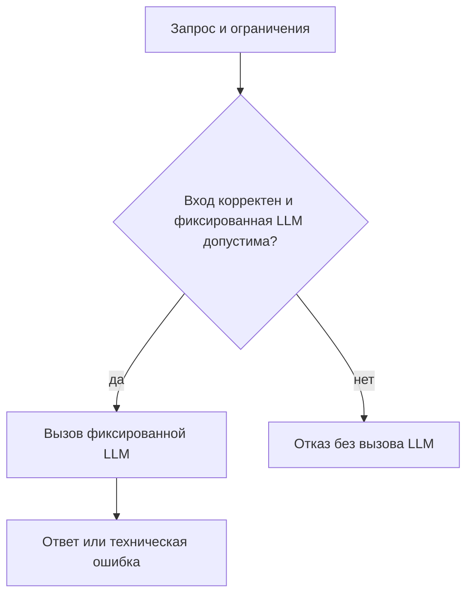
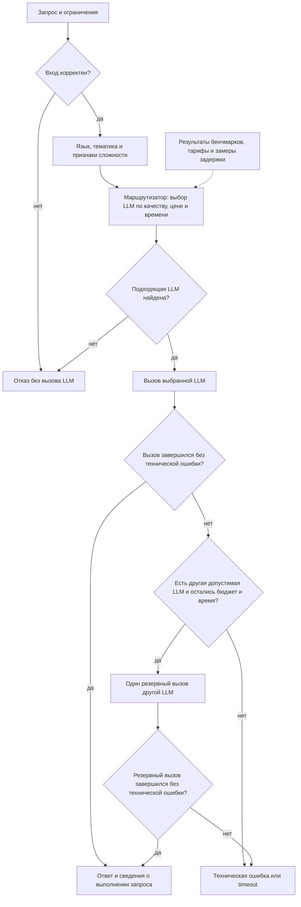

# Дизайн ML-системы — Smart LLM Router, MVP V1

- **Проект:** интеллектуальная маршрутизация между LLM.
- **Автор:** Mixlazer.
- **Версия:** V1, 29.10.2026.
- **Статус:** проект решения для ревью в рамках домашнего задания № 1.

Структура опирается на [шаблон Reliable ML](https://github.com/IrinaGoloshchapova/ml_system_design_doc_ru/blob/main/ML_System_Design_Doc_Template.md).
Разделы 1–2 описывают цели и методологию, разделы 3–4 — план пилота
и возможное внедрение.

В этой работе подготовлены репозиторий и дизайн-документ. Описанные ниже модели,
датасеты, сервис и эксперименты ещё не реализованы. Все численные пороги —
предложения автора для обсуждения с ментором, а не измеренные результаты
или подтверждённые требования реального заказчика.

## 1. Цели и предпосылки

### 1.1 Зачем идём в разработку продукта?

**Пользователь продукта** — разработчик приложения с LLM, например учебного
ассистента, которому нужно отвечать на разнородные запросы на русском и английском.
**Заинтересованные стороны:** владелец приложения контролирует расходы и качество;
конечный пользователь ожидает полезный ответ без длительного ожидания.
В учебном проекте роли владельца продукта и ML-инженера выполняет автор;
реального заказчика и подтверждённого пользовательского трафика пока нет.

**Проблема.** В качестве исходного процесса предполагается ручной выбор одной
модели для всех запросов. Использование дорогой модели на простых вопросах
может создавать лишние затраты, а выбор дешёвой модели для сложной задачи —
ухудшать ответы. Единая модель также может быть неодинаково полезна в разных
доменах и языках. Эти предположения нужно проверить на выбранном наборе LLM.

**Бизнес-цель** — уменьшить среднюю стоимость обработанного запроса при сохранении
приемлемого качества и контроле задержки. Интеграция с приложением должна
избавить разработчика от ручного выбора LLM для каждого запроса.

**Почему нужен ML.** Простое правило по длине запроса не различает короткую
сложную задачу и длинный простой текст. Модель маршрутизации должна оценивать
вероятность приемлемого ответа каждой LLM по признакам запроса и накопленным
результатам бенчмарков. Польза ML должна быть подтверждена сравнением с простыми
правилами, а не предполагаться заранее.
Исследование [RouteLLM](https://arxiv.org/abs/2406.18665) рассматривает обучение
маршрутизации между более сильной и более дешёвой LLM. Оно служит основанием
для гипотезы, но не доказывает её для наших языков, моделей и запросов.

**Предварительный критерий успеха будущего MVP:** снижение средней стоимости
не менее чем на 30% относительно фиксированной опорной модели при потере
качества не более 0.02 по шкале [0, 1] и без роста p95 полной задержки.
Опорная модель и правила измерения определены в разделе 3.1.

### 1.2 Бизнес-требования и ограничения

#### Функциональные требования к будущему MVP

| ID | Требование | Проверяемый результат |
| --- | --- | --- |
| БТ-1 | Принимать один текстовый запрос и ограничения клиента | На входе есть текст, бюджет запроса, предельное время ответа и лимит выходных токенов |
| БТ-2 | Учитывать язык, домен и сложность | Для запроса формируются признаки языка и домена, а также оценка риска ошибки дешёвой модели |
| БТ-3 | Выбирать одну из доступных LLM | Выбор опирается на прогноз качества, цены, измеренную задержку и доступность модели |
| БТ-4 | Возвращать результат и объяснение выбора | Клиент получает ответ, ID и версию LLM, код причины выбора, время и доступную информацию о стоимости |
| БТ-5 | Соблюдать ограничения и явно сообщать об отказе | При отсутствии допустимой модели возвращается ошибка; дорогая модель не вызывается в обход бюджета |
| БТ-6 | Поддерживать воспроизводимую оценку | Все стратегии сравниваются на одном зафиксированном тестовом наборе; версии данных, моделей и политики сохранены |

Типовой процесс пилота: разработчик передаёт запрос в единый интерфейс;
маршрутизатор проверяет ограничения, выбирает LLM, получает ответ и возвращает
его с метаданными. Автор анализирует качество и затраты по доменам и языкам.
Если маршрутизация не даёт выигрыша, сохраняется фиксированная стратегия.

#### Ограничения и рабочие допущения для планирования

| Область | Предлагаемая граница |
| --- | --- |
| Языки и домены | Русский и английский; общие вопросы, математика, генерация Python-кода — шесть срезов «язык × домен» |
| Набор моделей | Три LLM с зафиксированными версиями и разными профилями цены/качества; конкретные модели выбираются после проверки доступа и калибровочного прогона |
| Формат | Один текстовый запрос, без истории диалога, изображений, аудио и потоковой выдачи |
| Размер | До 4096 входных и до 512 выходных токенов; лимит проверяется с учётом токенизатора и служебного промпта каждой кандидатной LLM |
| Время | Предлагаемый общий дедлайн запроса — 30 секунд, включая выбор, сетевое ожидание и возможный резервный вызов |
| Нагрузка | Локальный учебный пилот, один запрос одновременно; требования к высокой нагрузке пока не заявляются |
| Вычисления | Маршрутизатор работает на CPU; обучение самих LLM и содержание GPU-инфраструктуры не планируются |
| Расходы | Бюджет платных экспериментов определяется до запуска по оценке стоимости сбора данных, разметки и повторных вызовов |
| Данные | Только открытые данные с проверенными условиями использования и специально составленные несекретные запросы; реальные пользовательские данные не предполагаются |

Качество и время ответа конкретного запроса заранее неизвестны. Бюджетный фильтр
должен использовать консервативную оценку расходов при заданном максимуме
выходных токенов, а фильтр задержки — эмпирическую оценку, которая не гарантирует
успешный ответ до дедлайна. По истечении дедлайна клиент получает `timeout`.
Для MVP выбираются модели, у которых можно ограничить все оплачиваемые токены;
если верхнюю границу расходов определить нельзя, такой вызов не допускается.

Ожидаемый результат **текущей работы** — проверяемый проект решения и рабочий
сетап репозитория. Ожидаемый результат **будущего пилота** — отчёт о проверке
гипотезы по критериям раздела 3, включая отрицательный результат.

### 1.3 Что входит в скоуп проекта/итерации, что не входит

| Этап | Входит | Не входит |
| --- | --- | --- |
| ДЗ №1, текущая итерация | Публичный репозиторий, README, Ruff, pre-commit, этот документ, схема бейзлайна и MVP | Сбор платного датасета, обучение, работающий API, измеренный выигрыш, создание PR до проверки автором |
| Первый работающий MVP, будущая итерация | Реестр трёх LLM, ru/en и три домена, бенчмарки, простые стратегии, обучаемый выбор LLM, ограниченный резервный вызов, офлайн-оценка и локальный пилот | Дообучение LLM, RAG, агенты и вызовы инструментов, мультимодальность, многошаговые диалоги, онлайн-обучение, коммерческий запуск |

В MVP закрываются БТ-1–БТ-6 в пределах указанных языков, доменов и нагрузки.
Остальные языки и домены, массовое обслуживание клиентов, авторизация пользователей,
биллинг и промышленный SLA остаются за границами этой итерации.

**Качество и воспроизводимость:** исходники и конфигурация хранятся в Git;
Ruff и pre-commit проверяют Python-код. В будущих экспериментах фиксируются
разбиение данных, seed, промпты, параметры генерации, версии LLM, дата тарифов,
версия маршрутизатора и окружение. Тестовый набор не используется для выбора
порогов или моделей. Для сетевых LLM полная побитовая повторяемость не обещается.

**Планируемый технический долг:** файловый реестр и пакетный пересчёт бенчмарков
вместо централизованного model registry; ручное обновление профилей после смены
версии LLM; локальные отчёты вместо промышленного мониторинга. Переход к сервису
с реальным трафиком потребует отдельного проектирования безопасности,
масштабирования, наблюдаемости и управления доступом.

### 1.4 Предпосылки решения

| Предпосылка | Зачем нужна | Как проверить и что делать при опровержении |
| --- | --- | --- |
| Качество LLM различается между языками и доменами | Иначе профили по срезам не помогают выбору | Измерить качество каждой LLM на одинаковых запросах; при отсутствии различий оставить простую стратегию |
| Есть запросы, где дешёвая LLM достаточна | На них может возникнуть экономия | Оценить долю таких запросов на train/validation; если её мало, пересмотреть гипотезу до обучения |
| Приемлемость ответа частично предсказуема по входу | На инференсе эталона и ответов всех LLM нет | Проверить прогноз на validation; если он не лучше правил, ML-роутер не принимать |
| Бенчмарки отражают будущий поток хотя бы в выбранных срезах | Иначе экономия на тесте не переносится на приложение | Провести отдельный пилот на новых задачах; до реального трафика выводы ограничить учебной выборкой |
| Профиль модели применим только к конкретной версии и условиям вызова | Цена, качество и задержка могут измениться | Фиксировать снимок профиля; при смене версии повторять калибровку и оценку |
| Есть разрешённые данные и доступ к трём LLM | Без этого нельзя собрать обучающие примеры | Проверить лицензии, доступ и стоимость; конкретный список пока является открытым решением |

**Единица решения** — один запрос, для которого выбирается одна основная LLM.
**Горизонт прогноза** — качество ответа и время выполнения этого запроса;
это не прогноз трафика на следующий день. Профили обновляются перед пилотом
и при изменении версии модели, тарифов или заметном сдвиге метрик.

«Сложность» трактуется операционно: как риск неприемлемого ответа более дешёвой
модели для данного запроса. Длина, признаки кода и тип задачи — только признаки,
а не доказательство сложности. Ещё одна дорогая LLM для классификации каждого
входа в первом MVP не вызывается.

## 2. Методология

### 2.1 Постановка задачи

Система должна выбирать LLM для каждого нового запроса. На вход она получает
текст и ограничения: сколько можно потратить, как долго можно ждать
и какой максимальный объём ответа нужен. На выходе — ответ выбранной LLM
и информация о выборе либо понятная причина отказа.

Для выбора используются результаты бенчмарков: как каждая LLM отвечает
на задачи разных тематик и языков, сколько стоят её вызовы и сколько времени
они занимают. Маршрутизатор учитывает также признаки самого запроса,
чтобы различать простые и сложные задачи внутри одной темы.

**С чем сравниваем решение:**

| Подход | Как выбирается LLM | Зачем сравниваем |
| --- | --- | --- |
| Фиксированная модель — основной бейзлайн | Одна и та же основная LLM для всех запросов; выбирается заранее по качеству на наборе для настройки | Проверить, сохраняется ли качество при снижении расходов |
| Самая дешёвая модель | Минимальная оценка стоимости запроса среди моделей, допустимых по ограничениям | Понять, оправдывает ли более сложный выбор дополнительные затраты |
| Табличные правила | Выбор по среднему качеству моделей для языка и темы запроса | Проверить пользу индивидуальной оценки сложности |
| Обучаемый маршрутизатор — основной MVP | По признакам нового запроса оценивает, какие LLM смогут ответить приемлемо | Проверить пользу обучения по сравнению с простыми правилами |

Для всех подходов действуют одинаковые лимиты на стоимость, время и размер ответа.
Сравнение стратегий проводится в эксперименте; пользователь не выбирает
между ними при каждом обращении к работающему MVP.

**Как работает MVP:**

1. Проверить текст и параметры запроса. Пустой или слишком большой запрос
   отклоняется до обращения к LLM.
2. Определить язык, тематику и признаки сложности: например, наличие кода,
   нескольких подзадач или требований к ответу. Эти признаки обрабатываются
   локально; отдельная дорогая LLM для анализа входа не вызывается.
3. Исключить недоступные модели и те, для которых недостаточно бюджета,
   времени или размера контекста. Используются актуальные тарифы, лимит
   генерации и ранее измеренные задержки.
4. Среди оставшихся выбрать самую дешёвую LLM, для которой маршрутизатор
   ожидает приемлемое качество. Минимальный уровень качества настраивается
   заранее на выделенном наборе запросов, а не на итоговом тесте.
   При одинаковой цене предпочтительнее меньшая ожидаемая задержка.
5. Если уверенного выбора нет, в том числе для незнакомого языка или темы,
   использовать фиксированную модель бейзлайна, только если она допустима
   по ресурсам. Иначе вернуть отказ без вызова провайдера.
6. Вызвать выбранную LLM и вернуть ответ с названием модели, причиной выбора,
   временем и сведениями о расходах.

При техническом сбое провайдера разрешена одна попытка с другой LLM.
Резервная LLM выбирается по тем же правилам, с исключением уже использованной.
Перед ней заново проверяются оставшиеся бюджет и время; стоимость первой
попытки учитывается, даже если ответ не был получен. Если и резервная попытка
завершилась сбоем или общее время истекло, возвращается ошибка.

Маршрутизатор не знает правильный ответ заранее. Он оценивает вероятность
приемлемого результата по накопленным примерам. Среднее качество на бенчмарке
не гарантирует правильность конкретного ответа, а прогноз задержки
не гарантирует ответ до дедлайна. Повторный вызов из-за сомнений в содержании
ответа в первый MVP не входит.

### 2.2 Блок-схема решения

На схемах ниже показана обработка нового запроса. Результаты бенчмарков
и маршрутизатор готовятся заранее по этапам из раздела 2.3.
Эталонные ответы и тестовая разметка не подаются маршрутизатору вместе
с новым запросом.

**Бейзлайн — одна фиксированная LLM:**

Фиксированная модель выбирается до итогового теста и не меняется в зависимости
от темы запроса. Для честного сравнения у неё те же бюджет и дедлайн,
что у MVP, и такой же порядок обработки технических сбоев: не более одной
резервной попытки с другой допустимой моделью. Диаграмма показывает основной путь.
Основная и резервная модели для бейзлайна фиксируются заранее.

**MVP — выбор LLM для конкретного запроса:**

В блоке выбора уже проверяются ограничения, поэтому при отсутствии подходящей
LLM вызов не выполняется. Неуверенный выбор обрабатывается по правилу
фиксированной модели из раздела 2.1. Резервная попытка показана отдельно:
возврата к началу и неограниченных повторов нет. Общий дедлайн и бюджет
не начинаются заново. Если провайдер мог списать деньги за неудачную попытку,
эта сумма учитывается при решении о резервном вызове.

Успех на схеме означает получение ответа от API, а не проверку его правильности.
Отдельной LLM-проверки каждого ответа в MVP нет. Для каждого исхода сохраняются
статус, выбранные модели, число попыток, время и известные расходы;
тексты запросов и ответов в эксплуатационные логи не записываются.

### 2.3 Этапы решения задачи

**1. Выбрать модели и подготовить задачи.** Для начала нужны три доступные LLM
с фиксированными версиями и задачи на русском и английском: общие вопросы,
математика и Python. Конкретные модели, датасеты и лицензии пока не выбраны.
Внешние рейтинги помогают найти кандидатов, но для сравнения нужны ответы
на одни и те же задачи при одинаковых ограничениях.

**2. Разделить данные.** Одни запросы используются для обучения маршрутизатора,
другие — для настройки правил и выбора фиксированной модели, третьи — только
для итоговой проверки. Дубликаты, переводы и варианты одной задачи целиком
попадают в одну часть. Объём определяется после оценки стоимости и того,
достаточно ли примеров для надёжного сравнения качества.

**3. Собрать ответы и результаты бенчмарков.** Каждая LLM отвечает на подготовленные
запросы; сохраняются версия модели, ответ, число токенов, стоимость, время
и статус вызова. Для каждого ответа отмечается, приемлем он или нет.
Общие вопросы проверяются по эталонам и заранее заданной рубрике, математика —
по эталонным решениям, Python — по тестам в изолированной среде.
Спорные случаи проверяются вручную. Это позволяет получить сопоставимые
оценки качества моделей по языкам и темам.

**4. Подготовить маршрутизатор.** На обучающей части он учится по признакам
запроса оценивать, какие LLM дадут приемлемый ответ. Конкретный алгоритм
выбирается после изучения данных, начиная с простой модели. На части для
настройки выбираются уровень требуемого качества и параметры маршрутизации.
Язык, тема и признаки сложности при проверке определяются тем же способом,
что и на новых запросах; готовые правильные метки не подсказываются системе.

**5. Сравнить подходы на итоговом тесте.** После фиксации настроек проверяются
качество, расходы и задержки маршрутизатора и простых стратегий.
Эталонные ответы и фактическое время будущего вызова не подаются на вход роутеру.
Если обучение не даёт полезного выигрыша относительно табличных правил,
сохраняется простой вариант и фиксируется результат эксперимента.

**6. Подготовить пилот.** При выполнении критериев из раздела 3 провести отдельный
прогон на новых несекретных задачах. Итоговый тест не используется для
повторной настройки; после изменений потребуется новая независимая проверка.
В отчёте сохраняются версии данных, моделей, промптов, тарифов и настроек,
чтобы можно было объяснить и повторить эксперимент.

## 3. Подготовка пилота

### 3.1 Способ оценки пилота

Пилот — локальная проверка на новых задачах без реального пользовательского
трафика. Сравниваются обучаемый маршрутизатор, фиксированная модель,
самая дешёвая допустимая модель и табличные правила при общих условиях.

Фиксированная модель выбирается по среднему качеству по языкам и темам
на части данных для настройки, после чего выбор фиксируется. Основное сравнение
проводится при общих ограничениях, в которых эта модель допустима.
Недостаточный бюджет проверяется отдельно как сценарий отказа.

Качество — среднее шести долей приемлемых ответов по срезам «язык × домен».
Ошибки, таймауты и отказы входят в знаменатель и оцениваются как неприемлемые ответы.
Равные веса срезов — учебное допущение: распределение будущего трафика неизвестно.
Средняя стоимость — суммарные расходы, включая резервные и неудачные вызовы,
делённые на все входные запросы. Дополнительно публикуются стоимость успешного
ответа и доля ошибок, чтобы отказ от обслуживания не выглядел экономией.
Полная задержка измеряется от приёма запроса до ответа или конечной ошибки;
отдельно показывается задержка успешных ответов, чтобы быстрые отказы не
маскировали медленную генерацию.

Доверительный интервал качества оценивается парным bootstrap по группам задач
со стратификацией по срезам. Если интервал шире допустимого, результат считается
неопределённым, даже если точечная оценка выглядит хорошо. Достаточность объёма
теста проверяется до итогового сравнения по разбросу результатов на предварительных данных.

Офлайн-матрица позволяет сравнивать качество и расчётную цену выбора на одних
ответах. Расходы на сбор этой матрицы показываются отдельно от оценочной цены
обслуживания маршрутизатором. Накладные вычисления учитываются отдельно и
включаются в итоговую оценку себестоимости с указанным способом расчёта.
Нельзя выдавать воспроизведение сохранённых задержек за end-to-end измерение:
полная задержка и поведение резервного вызова измеряются на живом стенде.

### 3.2 Что считаем успешным пилотом

| Показатель | Предварительный критерий | Способ проверки |
| --- | --- | --- |
| Стоимость | Снижение не менее чем на 30% относительно фиксированной модели | Один набор запросов и единые тарифы; учитывать все попытки и стоимость маршрутизатора |
| Качество | Потеря относительно фиксированной модели не более 0.02 по шкале [0, 1] | Парное сравнение на закрытом test и односторонняя 95% верхняя доверительная граница потери не выше 0.02 |
| Качество по срезам | Точечная потеря не более 0.05 в каждом из шести срезов | Показать размер каждого среза и интервалы; малый объём данных означает предварительный вывод |
| Полная задержка | p95 не выше, чем у фиксированной модели | Отдельный живой прогон, единая нагрузка и перемешанный порядок стратегий; также показать p50 |
| Накладные расходы выбора | p95 не более 100 мс | Замер на указанном CPU при одном одновременном запросе, без времени LLM |
| Надёжность | Доля ошибок не выше фиксированной модели более чем на 0.01 | Учитывать таймауты, отказы и исчерпание бюджета на одном наборе |
| Ограничения | Ни одного вызова, нарушающего резерв бюджета или число попыток | Проверки граничных случаев и ошибок с подменённым провайдером |

Обучаемый маршрутизатор принимается только при выполнении критериев и полезном
выигрыше относительно табличных правил. При отсутствии статистически убедительного результата
фиксируется неопределённость, проводится пересмотр данных или сохраняется
простая стратегия. A/B-тест на пользователях и промышленное внедрение
потребуют новой итерации и здесь не обещаются.

### 3.3 Подготовка пилота

До платных вызовов выбираются доступные версии LLM, проверяются лицензии данных,
фиксируются рубрики и рассчитывается бюджет всего эксперимента, включая разметку.
Сначала небольшой калибровочный прогон проверяет реалистичность затрат и лимитов.
При недостаточной мощности теста потребуется увеличить выборку либо признать
ограниченность вывода. CPU-среда и параметры внешних LLM фиксируются в отчёте.

## 4. Внедрение

Раздел описывает план следующей итерации; промышленный деплой в ДЗ №1 не выполняется.

### 4.1 Архитектура решения

Первый MVP — Python-процесс с валидатором запросов, извлечением признаков,
маршрутизатором, правилами выбора и адаптерами LLM-провайдеров.
Профили и политика загружаются из версионированных файлов, экспериментальные
данные хранятся в JSONL/таблицах. Отдельные микросервисы и БД пока не требуются.

### 4.2 Инфраструктура и масштабируемость

Локальная CPU-среда для роутера и внешние API для LLM позволяют проверить
гипотезу без собственной GPU-инфраструктуры. Цена решения — зависимость от сети,
лимитов и доступности провайдеров. Масштабирование и нагрузочные испытания
добавляются после подтверждения полезности на одном одновременном запросе.

### 4.3 Требования к работе системы

Общий дедлайн — 30 секунд, максимум две попытки. Резервный вызов использует
оставшееся время и бюджет. Неактуальные профили исключаются из выбора.
Предварительные показатели задержки — критерии эксперимента, а не production SLA.

**Проверяемые сценарии:**

- Если вход пустой, параметры некорректны или размер превышает лимит,
  возвращается `invalid_request` без вызова провайдера.
- Если для запроса ожидается приемлемый ответ дешёвой допустимой LLM,
  выбирается самая дешёвая из таких моделей.
- Если уверенного выбора нет, используется фиксированная модель при достаточных
  ресурсах; иначе возвращается `no_feasible_model`.
- Для неподдерживаемого языка, домена или низкой уверенности классификации
  применяется тот же путь фиксированной модели; соответствующие запросы отмечаются
  отдельно от шести основных срезов и не входят в заявления о качестве на них.
- При недоступности провайдера допускается только одна замена в пределах
  остатка бюджета и времени; общий дедлайн не начинается заново.
- Метаданные показывают все попытки, статус и известную либо зарезервированную
  стоимость. Полные запросы и ответы не попадают в эксплуатационные логи.

### 4.4 Безопасность системы

Ключи провайдеров передаются через переменные окружения и не записываются в Git.
Сгенерированный Python-код исполняется для оценки только в изолированной среде
без сети и секретов, с ограничениями CPU, памяти и времени.
До открытия API внешним пользователям потребуются авторизация и лимиты запросов.

### 4.5 Безопасность данных

В пилоте используются только несекретные задачи. Эксплуатационные логи содержат
ID запроса, выбранную модель, версию политики, статусы, токены, расходы и время;
полные тексты запросов и ответов в них не сохраняются. Данные экспериментов
публикуются только при разрешённых условиях использования.
Автоматическая фильтрация персональных данных не заявляется реализованной.

### 4.6 Издержки

Расходы складываются из входных и выходных токенов LLM, возможных повторов,
разметки и вычислений роутера. Верхняя оценка вызова учитывает максимум всех
оплачиваемых выходных токенов. Модель без определимой верхней границы расходов
не допускается к бюджетно ограниченному вызову. Конкретные тарифы и месячная
оценка появятся после выбора провайдеров и профиля нагрузки.

### 4.7 Точки интеграции

Планируется единый интерфейс `POST /route`: текст, бюджет, дедлайн и лимит выхода
на входе; ответ, выбранная LLM, причина выбора, сведения о попытках, времени
и известной либо зарезервированной стоимости на выходе. Сейчас endpoint не реализован.
Адаптеры приводят ответы и ошибки провайдеров к общему формату.

### 4.8 Риски

| Риск | Последствие | Предлагаемая мера |
| --- | --- | --- |
| Утечка между train и test через переводы и дубликаты | Завышенная оценка роутера | Групповое разбиение до обучения, дедупликация и отдельный пилот |
| Публичные задачи могли быть в обучении самих LLM | Бенчмарк не отражает новые запросы | Новые авторские задачи и явное ограничение выводов |
| Разные рубрики и ошибка оценщика | Несопоставимое качество или смещённые метки | Фиксировать рубрику до test, проверять спорные ответы и согласованность разметки |
| Ошибка в языке или домене, смена тематики | Неверный выбор дешёвой LLM | Оценивать весь конвейер с предсказанными признаками, использовать консервативный маршрут |
| Новая версия модели, тариф или нагрузка провайдера | Устаревшие качество, цена и p95 | Версионирование реестра, повторная калибровка, исключение устаревших профилей |
| Повторный вызов после ошибки тоже оплачивается | Перерасход и скрытые затраты | Резервирование расходов, максимум две попытки и общий дедлайн |
| Конфиденциальный текст уйдёт внешнему провайдеру | Неприемлемая обработка данных | В пилоте только несекретные задачи; ключи вне Git; без текстов в эксплуатационных логах |
| Выполнение сгенерированного Python-кода | Повреждение среды или доступ к секретам | Только изолированная среда без сети и секретов, с лимитами CPU, памяти и времени |

**Открытые решения перед реализацией:**

1. Какие три версии LLM доступны по условиям использования, стоимости и регионам?
2. Какие наборы данных покрывают все шесть срезов и допускают нужное использование?
3. Каковы окончательные рубрики приемлемости и согласованность разметчиков?
4. Подтверждаются ли пороги 30%, 0.02 и 100 мс после калибровки, и достаточно ли данных?
5. Укладывается ли сбор данных, включая оценку ответов, в согласованный бюджет?

Эти решения нужны перед запуском экспериментов, но не означают, что для ДЗ №1
уже должны существовать обученные модели или результаты пилота.

## Источники

- [Reliable ML: шаблон дизайн-документа](https://github.com/IrinaGoloshchapova/ml_system_design_doc_ru/blob/main/ML_System_Design_Doc_Template.md) — структура разделов и требование показать бейзлайн на схеме.
- [RouteLLM: Learning to Route LLMs with Preference Data](https://arxiv.org/abs/2406.18665) — исследовательская предпосылка обучаемой маршрутизации.
- [Официальный репозиторий RouteLLM](https://github.com/lm-sys/RouteLLM) — пример сравнения маршрутизаторов и калибровки порога на целевых запросах; не обязательная зависимость проекта.
