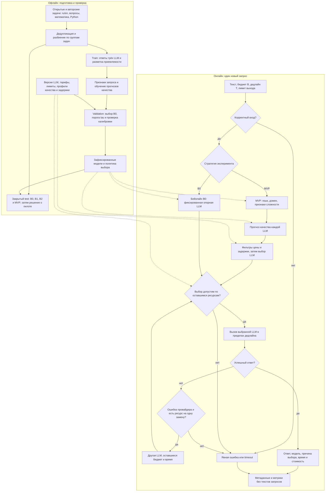

# ML System Design Doc: Smart LLM Router

- **Проект:** интеллектуальная маршрутизация между LLM.
- **Автор:** Mixlazer.
- **Версия:** 0.1, 29.10.2026.
- **Статус:** проект решения для ревью в рамках домашнего задания № 1.

Структура опирается на [шаблон Reliable ML](https://github.com/IrinaGoloshchapova/ml_system_design_doc_ru/blob/main/ML_System_Design_Doc_Template.md).
Разделы 1–2 покрывают требования ДЗ №1; разделы 3–5 уточняют проверку гипотез,
риски и вопросы для следующей итерации.

В этой работе подготовлены репозиторий и дизайн-документ. Описанные ниже модели,
датасеты, сервис и эксперименты ещё не реализованы. Все численные пороги —
предложения автора для обсуждения с ментором, а не измеренные результаты
или подтверждённые требования реального заказчика.

## 1. Цели и предпосылки

### 1.1. Зачем идём в разработку продукта?

**Пользователь продукта** — разработчик приложения с LLM, например учебного
ассистента, которому нужно отвечать на разнородные запросы на русском и английском.
**Заинтересованные стороны:** владелец приложения контролирует расходы и качество;
конечный пользователь ожидает полезный ответ без длительного ожидания.
В учебном проекте роли владельца продукта и ML-инженера выполняет автор;
реального заказчика и подтверждённого пользовательского трафика пока нет.

**Проблема.** В качестве исходного процесса предполагается ручной выбор одной
модели для всех запросов. Использование дорогой модели на простых вопросах
может создавать лишние затраты, а выбор дешёвой модели для сложной задачи —
ухудшать ответы. Единая модель также может быть неодинаково полезна в разных
доменах и языках. Эти предположения нужно проверить на выбранном наборе LLM.

**Бизнес-цель** — уменьшить среднюю стоимость обработанного запроса при сохранении
приемлемого качества и контроле задержки. Интеграция с приложением должна
избавить разработчика от ручного выбора LLM для каждого запроса.

**Почему нужен ML.** Простое правило по длине запроса не различает короткую
сложную задачу и длинный простой текст. Модель маршрутизации должна оценивать
вероятность приемлемого ответа каждой LLM по признакам запроса и накопленным
результатам бенчмарков. Польза ML должна быть подтверждена сравнением с простыми
правилами, а не предполагаться заранее.
Исследование [RouteLLM](https://arxiv.org/abs/2406.18665) рассматривает обучение
маршрутизации между более сильной и более дешёвой LLM. Оно служит основанием
для гипотезы, но не доказывает её для наших языков, моделей и запросов.

**Предварительный критерий успеха будущего MVP:** снижение средней стоимости
не менее чем на 30% относительно фиксированной опорной модели при потере
качества не более 0.02 по шкале [0, 1] и без роста p95 полной задержки.
Опорная модель и правила измерения определены в разделе 3.1.

### 1.2. Бизнес-требования и ограничения

#### Функциональные требования к будущему MVP

| ID | Требование | Проверяемый результат |
| --- | --- | --- |
| БТ-1 | Принимать один текстовый запрос и ограничения клиента | На входе есть текст, бюджет запроса, предельное время ответа и лимит выходных токенов |
| БТ-2 | Учитывать язык, домен и сложность | Для запроса формируются признаки языка и домена, а также оценка риска ошибки дешёвой модели |
| БТ-3 | Выбирать одну из доступных LLM | Выбор опирается на прогноз качества, цены, измеренную задержку и доступность модели |
| БТ-4 | Возвращать результат и объяснение выбора | Клиент получает ответ, ID и версию LLM, код причины выбора, время и доступную информацию о стоимости |
| БТ-5 | Соблюдать ограничения и явно сообщать об отказе | При отсутствии допустимой модели возвращается ошибка; дорогая модель не вызывается в обход бюджета |
| БТ-6 | Поддерживать воспроизводимую оценку | Все стратегии сравниваются на одном зафиксированном тестовом наборе; версии данных, моделей и политики сохранены |

Типовой процесс пилота: разработчик передаёт запрос в единый интерфейс;
маршрутизатор проверяет ограничения, выбирает LLM, получает ответ и возвращает
его с метаданными. Автор анализирует качество и затраты по доменам и языкам.
Если маршрутизация не даёт выигрыша, сохраняется фиксированная стратегия.

#### Ограничения и рабочие допущения для планирования

| Область | Предлагаемая граница |
| --- | --- |
| Языки и домены | Русский и английский; общие вопросы, математика, генерация Python-кода — шесть срезов «язык × домен» |
| Набор моделей | Три LLM с зафиксированными версиями и разными профилями цены/качества; конкретные модели выбираются после проверки доступа и калибровочного прогона |
| Формат | Один текстовый запрос, без истории диалога, изображений, аудио и потоковой выдачи |
| Размер | До 4096 входных и до 512 выходных токенов; лимит проверяется с учётом токенизатора и служебного промпта каждой кандидатной LLM |
| Время | Предлагаемый общий дедлайн запроса — 30 секунд, включая выбор, сетевое ожидание и возможный резервный вызов |
| Нагрузка | Локальный учебный пилот, один запрос одновременно; требования к высокой нагрузке пока не заявляются |
| Вычисления | Маршрутизатор работает на CPU; обучение самих LLM и содержание GPU-инфраструктуры не планируются |
| Расходы | Предлагаемый потолок платных экспериментов — 30 USD за итерацию; до согласования бюджета и моделей платные вызовы не запускаются |
| Данные | Только открытые данные с проверенными условиями использования и специально составленные несекретные запросы; реальные пользовательские данные не предполагаются |

Бюджет 30 USD не является оценкой достаточности: сначала на небольшой выборке
рассчитывается стоимость полного эксперимента, включая разметку и повторные вызовы.
Если она выше лимита, до запуска пересматриваются выбор моделей, размер выборки
или бюджет. Нельзя молча уменьшить тест и сохранить прежнюю уверенность в выводах.

Качество и время ответа конкретного запроса заранее неизвестны. Бюджетный фильтр
должен использовать консервативную оценку расходов при заданном максимуме
выходных токенов, а фильтр задержки — эмпирическую оценку, которая не гарантирует
успешный ответ до дедлайна. По истечении дедлайна клиент получает `timeout`.
Для MVP выбираются модели, у которых можно ограничить все оплачиваемые токены;
если верхнюю границу расходов определить нельзя, такой вызов не допускается.

Ожидаемый результат **текущей работы** — проверяемый проект решения и рабочий
сетап репозитория. Ожидаемый результат **будущего пилота** — отчёт о проверке
гипотезы по критериям раздела 3, включая отрицательный результат.

### 1.3. Что входит в скоуп проекта/итерации, что не входит

| Этап | Входит | Не входит |
| --- | --- | --- |
| ДЗ №1, текущая итерация | Публичный репозиторий, README, Ruff, pre-commit, этот документ, схема бейзлайна и MVP | Сбор платного датасета, обучение, работающий API, измеренный выигрыш, создание PR до проверки автором |
| Первый работающий MVP, будущая итерация | Реестр трёх LLM, ru/en и три домена, бенчмарки, простые стратегии, обучаемый выбор LLM, ограниченный резервный вызов, офлайн-оценка и локальный пилот | Дообучение LLM, RAG, агенты и вызовы инструментов, мультимодальность, многошаговые диалоги, онлайн-обучение, коммерческий запуск |

В MVP закрываются БТ-1–БТ-6 в пределах указанных языков, доменов и нагрузки.
Остальные языки и домены, массовое обслуживание клиентов, авторизация пользователей,
биллинг и промышленный SLA остаются за границами этой итерации.

**Качество и воспроизводимость:** исходники и конфигурация хранятся в Git;
Ruff и pre-commit проверяют Python-код. В будущих экспериментах фиксируются
разбиение данных, seed, промпты, параметры генерации, версии LLM, дата тарифов,
версия маршрутизатора и окружение. Тестовый набор не используется для выбора
порогов или моделей. Для сетевых LLM полная побитовая повторяемость не обещается.

**Планируемый технический долг:** файловый реестр и пакетный пересчёт бенчмарков
вместо централизованного model registry; ручное обновление профилей после смены
версии LLM; локальные отчёты вместо промышленного мониторинга. Переход к сервису
с реальным трафиком потребует отдельного проектирования безопасности,
масштабирования, наблюдаемости и управления доступом.

### 1.4. Предпосылки решения

| Предпосылка | Зачем нужна | Как проверить и что делать при опровержении |
| --- | --- | --- |
| Качество LLM различается между языками и доменами | Иначе профили по срезам не помогают выбору | Измерить качество каждой LLM на одинаковых запросах; при отсутствии различий оставить простую стратегию |
| Есть запросы, где дешёвая LLM достаточна | На них может возникнуть экономия | Оценить долю таких запросов на train/validation; если её мало, пересмотреть гипотезу до обучения |
| Приемлемость ответа частично предсказуема по входу | На инференсе эталона и ответов всех LLM нет | Проверить прогноз на validation; если он не лучше правил, ML-роутер не принимать |
| Бенчмарки отражают будущий поток хотя бы в выбранных срезах | Иначе экономия на тесте не переносится на приложение | Провести отдельный пилот на новых задачах; до реального трафика выводы ограничить учебной выборкой |
| Профиль модели применим только к конкретной версии и условиям вызова | Цена, качество и задержка могут измениться | Фиксировать снимок профиля; при смене версии повторять калибровку и оценку |
| Есть разрешённые данные и доступ к трём LLM | Без этого нельзя собрать обучающие примеры | Проверить лицензии, доступ и стоимость; конкретный список пока является открытым решением |

**Единица решения** — один запрос, для которого выбирается одна основная LLM.
**Горизонт прогноза** — качество ответа и время выполнения этого запроса;
это не прогноз трафика на следующий день. Профили обновляются перед пилотом
и при изменении версии модели, тарифов или заметном сдвиге метрик.

«Сложность» трактуется операционно: как риск неприемлемого ответа более дешёвой
модели для данного запроса. Длина, признаки кода и тип задачи — только признаки,
а не доказательство сложности. Ещё одна дорогая LLM для классификации каждого
входа в первом MVP не вызывается.

## 2. Методология

### 2.1. Постановка задачи

Это задача контекстного выбора модели с ограничениями по ресурсам.
На вход подаются запрос `x`, бюджет `B`, дедлайн `T` и лимит генерации `N_out`.
Из реестра моделей `M` нужно выбрать LLM, которая с высокой вероятностью
ответит приемлемо и укладывается в ограничения.

| Сущность | Содержание |
| --- | --- |
| Признаки `phi(x)` | Текстовое представление запроса, определённые язык и домен, длина, признаки кода и структуры задачи; только информация, доступная до вызова LLM |
| Цель `y(x, m)` | 1, если ответ модели `m` на запрос `x` приемлем по заранее заданной рубрике, иначе 0; ошибка или отсутствие ответа также дают 0 |
| Прогноз `q_m(x)` | Оценка вероятности `y(x, m) = 1`, полученная на данных выбранной версии LLM |
| Оценка расходов `C_cap(x, m)` | Верхняя оценка стоимости с учётом входных токенов, максимума оплачиваемых выходных токенов и тарифа модели |
| Оценка времени `L_hat(x, m)` | Измеренный p95 времени ответа в сопоставимом диапазоне длины входа и лимита выхода |
| Выход | Ответ и метаданные выбора либо явная ошибка без допустимого вызова |

**Бейзлайны:** B0 — всегда использовать одну опорную LLM с наивысшим качеством
на validation; B1 — всегда использовать самую дешёвую допустимую LLM;
B2 — выбирать по таблице бенчмарков «LLM × язык × домен» без индивидуального
ML-прогноза. Все стратегии проходят одну и ту же проверку бюджета и дедлайна.

**Кандидат основного MVP:** лёгкая модель вероятности приемлемого ответа
для каждой LLM, например TF-IDF текста и логистическая регрессия с дополнительными
признаками языка, домена и длины. Язык определяется локально; классификатор домена
обучается на train-разметке. На validation используются его предсказания,
а не известные исследователю правильные метки домена. Профиль качества по срезам
служит ориентиром и отдельным бейзлайном B2. Окончательный выбор алгоритма зависит
от EDA; добавлять сложную нейросеть без выигрыша относительно B2 не требуется.

Правило маршрутизации:

1. Исключить недоступные LLM, неподходящий контекст и модели без актуального профиля.
2. Построить множество `F(x)` моделей с `C_cap(x, m) <= B` и
   `L_hat(x, m) + L_router <= T`, где `L_router` — оценка накладных расходов выбора.
3. Среди моделей `F(x)` с `q_m(x) >= tau` выбрать минимальную по `C_cap`;
   при равенстве — меньшую по `L_hat`, затем по стабильному ID.
   Порог `tau` выбирается только на validation по критериям качества и экономии.
4. Если порог не достигнут или вход вне поддерживаемого распределения,
   использовать B0, только если она допустима по ресурсам; иначе вернуть
   `no_feasible_model`. Ошибку формата возвращать до обращения к провайдеру.
5. При сетевой ошибке, rate limit или отказе провайдера допустим один резервный
   вызов другой модели. Выбор повторяется с оставшимся временем и бюджетом;
   уже потраченные или потенциально списанные средства учитываются.

Максимум — два вызова на пользовательский запрос. Неизвестная стоимость
первого вызова после таймаута резервируется по верхней границе до сверки.
Если ресурсов на вторую попытку нет, возвращается ошибка, а не скрытый
перерасход. Семантическая проверка ответа и повторная генерация «для улучшения
качества» в онлайн-пути первого MVP не планируются.

Прогноз `q_m(x)` не является гарантией правильности отдельного ответа.
Стратегия минимизирует консервативную стоимость среди достаточно качественных
кандидатов и учитывает задержку как ограничение; она не ищет недоказанный
«глобальный оптимум» одновременно по трём несопоставимым величинам.

### 2.2. Блок-схема решения

На схеме показаны офлайн-подготовка, отдельный путь бейзлайна B0 и путь MVP.
Ответы и оценки всех LLM доступны только офлайн. На новом запросе роутер
видит вход и сохранённые артефакты, а не будущие ответы моделей.

Возврат к выбору на схеме ограничен счётчиком двух попыток и общим дедлайном;
это не неограниченный цикл. B1 и B2 используют общий путь проверки и вызова,
заменяя только блок выбора модели. Онлайн-метаданные не становятся разметкой
качества автоматически: для нового обучающего набора нужна отдельная оценка.

### 2.3. Данные и этапы решения

Готового проектного датасета пока нет. Внешние лидерборды могут помочь выбрать
кандидатов, но оценки из разных методик нельзя напрямую считать сопоставимыми.
Для маршрутизации нужны ответы выбранных версий LLM на одних и тех же задачах.

| Данные | Источник и статус | Назначение |
| --- | --- | --- |
| Запросы, язык, домен, эталоны или тесты | Кандидаты: открытые QA, математические и кодовые бенчмарки и авторские задачи; конкретные наборы и лицензии ещё не проверены | Признаки, стратификация и независимая проверка |
| Ответы каждой LLM и метка `y(x, m)` | Предстоит собрать на выбранных моделях и проверить рубрику | Обучение прогноза качества и оценка стратегий |
| Число токенов, цена, задержка, статус вызова | Измерения экспериментального стенда; пока отсутствуют | Профили ресурсов и фактические затраты |
| Реестр моделей и тарифов | Официальные данные выбранных провайдеров на дату запуска; модели ещё не выбраны | Ограничения доступности, контекста и расходов |

План подготовки и проверки:

1. **Проверить реализуемость.** Выбрать три доступные версии LLM, данные
   с разрешённым использованием и одинаковую постановку задачи для всех моделей.
   На небольшом калибровочном наборе оценить затраты и разнообразие качества.
   Результат — согласованные бюджет, состав кандидатов и рубрика оценки.
2. **Подготовить данные.** Рабочий ориентир — 1800 запросов: 900 train,
   300 validation, 600 test, с примерно равными шестью срезами.
   Дубликаты, переводы и вариации одного задания должны целиком попадать
   в одно разбиение. Размер уточняется после оценки бюджета и мощности теста.
3. **Получить целевую переменную.** Общие вопросы оцениваются по эталону
   и рубрике правильности, полноты и языка; математика — по эталонному решению;
   Python — по заранее заданным тестам в изолированной среде.
   Для каждого домена до разметки фиксируется бинарный критерий приемлемости.
   Спорные ответы проверяются вручную; метки не сводятся только к мнению LLM-судьи.
4. **Построить B0–B2 и ML-кандидата.** Обучить преобразования и модели только
   на train. На validation выбрать B0, признаки и порог `tau`, проверить
   калибровку вероятностей и качество классификации домена. Если ML не улучшает
   простые стратегии, оставить B2 и зафиксировать отрицательный результат.
5. **Заморозить политику и оценить test.** Ответы тестовых LLM используются
   только для итоговой оценки выбранного маршрута. Не подавать в признаки
   ответы, эталоны, оценку судьи или фактическую задержку будущего вызова.
6. **Подготовить пилот.** При выполнении критериев провести отдельный
   end-to-end прогон на новых несекретных запросах. Не проводить повторное
   обучение на финальном test; после изменений нужен новый закрытый тест.

Данные экспериментов хранятся локально в версионированных JSONL/таблицах;
в Git публикуются разрешённые небольшие примеры, схемы и отчёты.
Основные ключи — `prompt_id`, `task_group_id`, `split`, `language`, `domain`,
`model_id`, `model_version`, `evaluation_version`. Сохраняются также настройки
генерации и дата вызова. Оценочные метки отделяются от входных признаков.

## 3. План проверки будущего MVP

### 3.1. Метрики и критерии успеха

Опорная B0 выбирается по максимальному macro-качеству на validation и затем
фиксируется. Для основного сравнения используется общий режим входных лимитов,
бюджета и дедлайна, в котором B0 допустима; случаи заведомо недостаточного
бюджета проверяются отдельно как сценарии отказа.

Качество `Q` — среднее шести долей приемлемых ответов по срезам «язык × домен».
Ошибки, таймауты и отказы входят в знаменатель и получают `y = 0`.
Равные веса срезов — учебное допущение: распределение будущего трафика неизвестно.
Стоимость `C` — суммарные расходы, включая резервные и неудачные вызовы,
делённые на все входные запросы. Дополнительно публикуются стоимость успешного
ответа и доля ошибок, чтобы отказ от обслуживания не выглядел экономией.
Полная задержка измеряется от приёма запроса до ответа или конечной ошибки;
отдельно показывается задержка успешных ответов, чтобы быстрые отказы не
маскировали медленную генерацию.

| Показатель | Предварительный критерий | Способ проверки |
| --- | --- | --- |
| Стоимость | `1 - C_MVP / C_B0 >= 0.30` | Один набор запросов и единые тарифы; учитывать все попытки и стоимость маршрутизатора |
| Качество | Потеря `Q_B0 - Q_MVP <= 0.02` | Парное сравнение на закрытом test и односторонняя 95% верхняя доверительная граница потери не выше 0.02 |
| Качество по срезам | Точечная потеря не более 0.05 в каждом из шести срезов | Показать размер каждого среза и интервалы; малый объём данных означает предварительный вывод |
| Полная задержка | `p95_MVP <= p95_B0` | Отдельный живой прогон, единая нагрузка и перемешанный порядок стратегий; также показать p50 |
| Накладные расходы выбора | p95 не более 100 мс | Замер на указанном CPU при одном одновременном запросе, без времени LLM |
| Надёжность | Доля ошибок не выше B0 более чем на 0.01 | Учитывать таймауты, отказы и исчерпание бюджета на одном наборе |
| Ограничения | Ни одного вызова, нарушающего резерв бюджета или число попыток | Проверки граничных случаев и ошибок с подменённым провайдером |

Доверительный интервал качества оценивается парным bootstrap по группам задач
со стратификацией по срезам. Если интервал шире допустимого, результат считается
неопределённым, даже если точечная оценка выглядит хорошо. Размер 600 тестовых
примеров не объявляется достаточным до расчёта мощности и оценки вариативности.

Офлайн-матрица позволяет сравнивать качество и расчётную цену выбора на одних
ответах. Расходы на сбор этой матрицы показываются отдельно от оценочной цены
обслуживания маршрутизатором. Накладные вычисления учитываются отдельно и
включаются в итоговую оценку себестоимости с указанным способом расчёта.
Нельзя выдавать воспроизведение сохранённых задержек за end-to-end измерение:
полная задержка и поведение резервного вызова измеряются на живом стенде.

### 3.2. Проверяемые сценарии поведения

- Если вход пустой, параметры некорректны или размер превышает лимит,
  возвращается `invalid_request` без вызова провайдера.
- Если простая задача имеет допустимую дешёвую модель с `q_m(x) >= tau`,
  выбирается минимальная по консервативной цене модель, а не B0 по умолчанию.
- Если дешёвые модели не проходят порог, выбирается B0 при достаточных ресурсах;
  иначе возвращается `no_feasible_model`.
- Для неподдерживаемого языка, домена или низкой уверенности классификации
  применяется тот же консервативный путь B0; соответствующие запросы отмечаются
  отдельно от шести основных срезов и не входят в заявления о качестве на них.
- При недоступности провайдера допускается только одна замена в пределах
  остатка бюджета и времени; общий дедлайн не начинается заново.
- Метаданные показывают все попытки, статус и известную либо зарезервированную
  стоимость. Полные запросы и ответы не попадают в эксплуатационные логи.

### 3.3. Решение о пилоте

Пилот — локальная проверка на новых задачах без реального пользовательского
трафика. В отчёте сравниваются B0, B1, B2 и ML-кандидат, включая разбиение
по ru/en и доменам, долю выбора каждой LLM и причины резервных вызовов.

ML-кандидат принимается только при выполнении критериев и полезном выигрыше
относительно B2. При отсутствии статистически убедительного результата
фиксируется неопределённость, проводится пересмотр данных или сохраняется
простая стратегия. A/B-тест на пользователях и промышленное внедрение
потребуют новой итерации и здесь не обещаются.

## 4. Риски и ограничения интерпретации

| Риск | Последствие | Предлагаемая мера |
| --- | --- | --- |
| Утечка между train и test через переводы и дубликаты | Завышенная оценка роутера | Групповое разбиение до обучения, дедупликация и отдельный пилот |
| Публичные задачи могли быть в обучении самих LLM | Бенчмарк не отражает новые запросы | Новые авторские задачи и явное ограничение выводов |
| Разные рубрики и ошибка оценщика | Несопоставимое качество или смещённые метки | Фиксировать рубрику до test, проверять спорные ответы и согласованность разметки |
| Ошибка в языке или домене, смена тематики | Неверный выбор дешёвой LLM | Оценивать весь конвейер с предсказанными признаками, использовать консервативный маршрут |
| Новая версия модели, тариф или нагрузка провайдера | Устаревшие качество, цена и p95 | Версионирование реестра, повторная калибровка, исключение устаревших профилей |
| Повторный вызов после ошибки тоже оплачивается | Перерасход и скрытые затраты | Резервирование расходов, максимум две попытки и общий дедлайн |
| Конфиденциальный текст уйдёт внешнему провайдеру | Неприемлемая обработка данных | В пилоте только несекретные задачи; ключи вне Git; без текстов в эксплуатационных логах |
| Выполнение сгенерированного Python-кода | Повреждение среды или доступ к секретам | Только изолированная среда без сети и секретов, с лимитами CPU, памяти и времени |

Автоматическая фильтрация персональных данных не заявляется реализованной.
Доступ к репозиторию не даёт согласия на передачу частных данных провайдерам.
Для MVP не используются сценарии принятия медицинских, юридических и других
критических решений, требующих отдельной оценки качества и ответственности.

## 5. Открытые решения перед реализацией

1. Какие три версии LLM доступны по условиям использования, стоимости и регионам?
2. Какие наборы данных покрывают все шесть срезов и допускают нужное использование?
3. Каковы окончательные рубрики приемлемости и согласованность разметчиков?
4. Подтверждаются ли пороги 30%, 0.02 и 100 мс после калибровки, и достаточно ли данных?
5. Укладывается ли сбор данных, включая оценку ответов, в согласованный бюджет?

Эти решения нужны перед запуском экспериментов, но не означают, что для ДЗ №1
уже должны существовать обученные модели или результаты пилота.

## Источники

- [Reliable ML: шаблон дизайн-документа](https://github.com/IrinaGoloshchapova/ml_system_design_doc_ru/blob/main/ML_System_Design_Doc_Template.md) — структура разделов и требование показать бейзлайн на схеме.
- [RouteLLM: Learning to Route LLMs with Preference Data](https://arxiv.org/abs/2406.18665) — исследовательская предпосылка обучаемой маршрутизации.
- [Официальный репозиторий RouteLLM](https://github.com/lm-sys/RouteLLM) — пример сравнения маршрутизаторов и калибровки порога на целевых запросах; не обязательная зависимость проекта.
