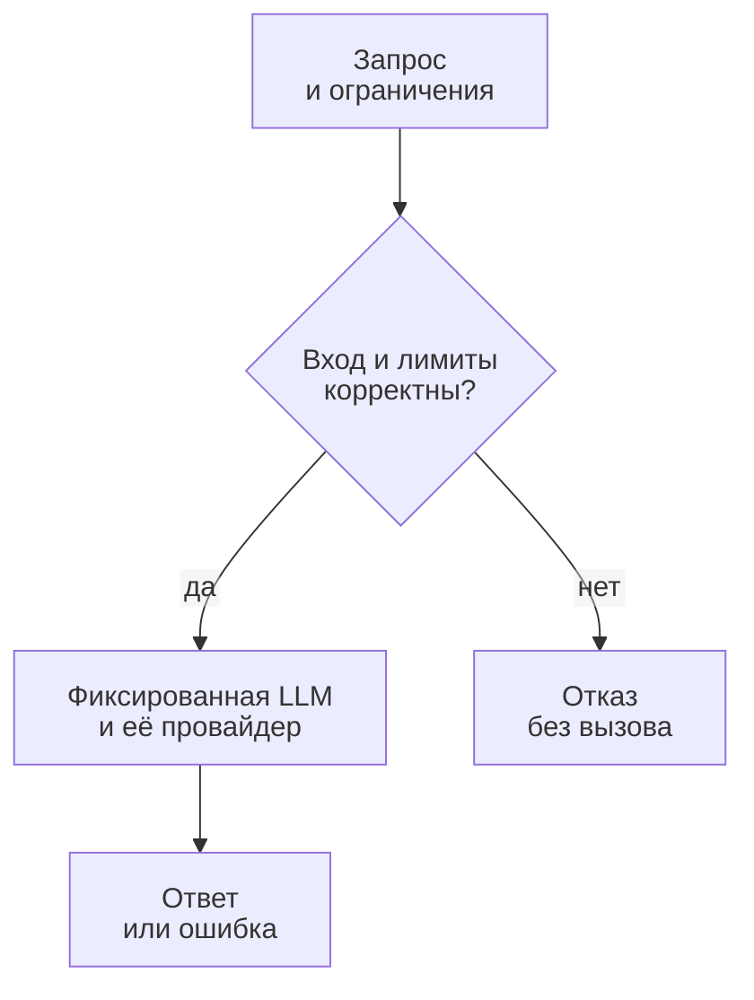
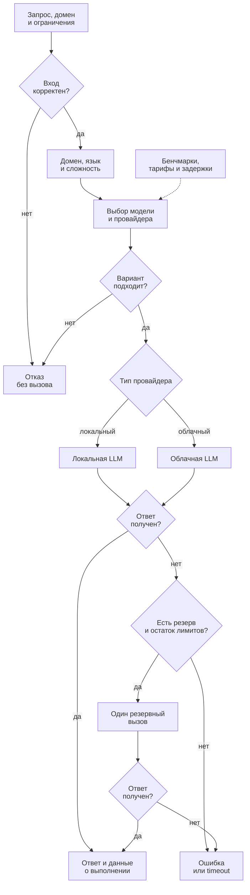

# Дизайн ML-системы — Smart LLM Router, MVP V1

- **Проект:** интеллектуальная маршрутизация между LLM.
- **Автор:** Лазарчик Михаил Павлович, ИТМО.
- **Версия:** V1, 29.10.2026.
- **Статус:** проект решения для ревью в рамках домашнего задания № 1.

Структура опирается на [шаблон Reliable ML](https://github.com/IrinaGoloshchapova/ml_system_design_doc_ru/blob/main/ML_System_Design_Doc_Template.md).
Разделы 1–2 описывают цели и методологию, разделы 3–4 — план пилота
и возможное внедрение.

В этой работе подготовлены репозиторий и дизайн-документ. Описанные ниже модели,
датасеты, сервис и эксперименты ещё не реализованы. Все численные пороги —
предложения автора для обсуждения с ментором, а не измеренные результаты
или подтверждённые требования реального заказчика.

## 1. Цели и предпосылки

### 1.1 Зачем идём в разработку продукта?

**Пользователь продукта** — разработчик приложения с LLM, например учебного
ассистента, которому нужно отвечать на разнородные запросы на русском и английском.
**Заинтересованные стороны:** владелец приложения контролирует расходы и качество;
конечный пользователь ожидает полезный ответ без длительного ожидания.
В учебном проекте роли владельца продукта и ML-инженера выполняет автор;
реального заказчика и подтверждённого пользовательского трафика пока нет.

**Проблема.** В качестве исходного процесса предполагается ручной выбор одной
модели для всех запросов. Использование дорогой модели на простых вопросах
может создавать лишние затраты, а выбор дешёвой модели для сложной задачи —
ухудшать ответы. Единая модель также может быть неодинаково полезна в разных
доменах и языках. Эти предположения нужно проверить на выбранном наборе LLM.

**Бизнес-цель** — уменьшить среднюю стоимость обработанного запроса при сохранении
приемлемого качества и контроле задержки. Интеграция с приложением должна
избавить разработчика от ручного выбора LLM для каждого запроса.

**Почему автоматический подбор может улучшить ситуацию.** Для готовых LLM
заранее измеряются качество по доменам и языкам, стоимость и задержка.
Правила маршрутизации сопоставляют характеристики задания с этими результатами
и выбирают подходящую модель. Например, задача с Python-кодом направляется
к модели с хорошими результатами в программировании, а математическая задача —
к модели с подходящим профилем для математики, если она укладывается в ограничения.
Решение использует готовые LLM и настраиваемые правила, без изменения весов моделей.
Должны поддерживаться как локальные серверы моделей, так и облачные API.

**Предварительный критерий успеха будущего MVP:** снижение средней стоимости
не менее чем на 30% относительно фиксированной опорной модели при потере
качества не более 0.02 по шкале [0, 1] и без роста p50/p95/p99 полной задержки.
Снижение расходов считается по полной стоимости, включая локальные вычисления
и работу роутера. Метрики определены в разделе 2.4, порядок сравнения — в разделе 3.1.

### 1.2 Бизнес-требования и ограничения

#### Функциональные требования к будущему MVP

| ID | Требование | Проверяемый результат |
| --- | --- | --- |
| БТ-1 | Принимать один текстовый запрос и ограничения клиента | На входе есть текст, бюджет запроса, предельное время ответа и лимит выходных токенов |
| БТ-2 | Автоматически подбирать LLM под домен задания | Домен берётся из явного указания клиента либо определяется по правилам; при выборе учитываются также язык и признаки сложности |
| БТ-3 | Выбирать одну из доступных готовых LLM | Выбор опирается на доменные бенчмарки, стоимость, измеренную задержку и доступность модели у конкретного провайдера |
| БТ-4 | Возвращать результат и объяснение выбора | Клиент получает ответ, ID и версию LLM, код причины выбора, время и доступную информацию о стоимости |
| БТ-5 | Соблюдать ограничения и явно сообщать об отказе | При отсутствии допустимой модели возвращается ошибка; дорогая модель не вызывается в обход бюджета |
| БТ-6 | Поддерживать воспроизводимую оценку | Все стратегии сравниваются на одном зафиксированном тестовом наборе; версии данных, моделей и правил сохранены |
| БТ-7 | Работать с локальными и облачными провайдерами | Единый интерфейс вызова; выбор и резервная попытка используют только разрешённых провайдеров |

Типовой процесс пилота: разработчик передаёт запрос в единый интерфейс;
маршрутизатор проверяет ограничения, выбирает LLM, получает ответ и возвращает
его с метаданными. Автор анализирует качество и затраты по доменам и языкам.
Если маршрутизация не даёт выигрыша, сохраняется фиксированная стратегия.

#### Ограничения и рабочие допущения для планирования

| Область | Предлагаемая граница |
| --- | --- |
| Языки и домены | Русский и английский; общие вопросы, математика, генерация Python-кода — шесть срезов «язык × домен» |
| Набор моделей | Три готовые LLM с фиксированными версиями, включая хотя бы одну локальную и одну облачную; конкретные варианты выбираются после проверки доступа и ресурсов |
| Формат | Один текстовый запрос, без истории диалога, изображений, аудио и потоковой выдачи |
| Размер | До 4096 входных и до 512 выходных токенов; лимит проверяется с учётом токенизатора и служебного промпта каждой кандидатной LLM |
| Время | Предлагаемый общий дедлайн запроса — 30 секунд, включая выбор, сетевое ожидание и возможный резервный вызов |
| Нагрузка | Локальный учебный пилот, один запрос одновременно; требования к высокой нагрузке пока не заявляются |
| Вычисления | Маршрутизатор работает на CPU; локальные LLM используют доступные CPU/GPU пользователя, пригодность оборудования и конфигурация проверяются до пилота |
| Расходы | Бюджет платных экспериментов определяется до запуска по оценке стоимости сбора данных, разметки и повторных вызовов |
| Данные | Только открытые данные с проверенными условиями использования и специально составленные несекретные запросы; реальные пользовательские данные не предполагаются |

Качество и время ответа конкретного запроса заранее неизвестны. Бюджетный фильтр
должен использовать консервативную оценку расходов при заданном максимуме
выходных токенов, а фильтр задержки — эмпирическую оценку, которая не гарантирует
успешный ответ до дедлайна. По истечении дедлайна клиент получает `timeout`.
Для MVP выбираются модели, у которых можно ограничить все оплачиваемые токены;
если верхнюю границу расходов определить нельзя, такой вызов не допускается.

Ожидаемый результат **текущей работы** — проверяемый проект решения и рабочий
сетап репозитория. Ожидаемый результат **будущего пилота** — отчёт о проверке
гипотезы по критериям раздела 3, включая отрицательный результат.

### 1.3 Что входит в скоуп проекта/итерации, что не входит

| Этап | Входит | Не входит |
| --- | --- | --- |
| ДЗ №1, текущая итерация | Публичный репозиторий, README, Ruff, pre-commit, этот документ, схема бейзлайна и MVP | Платные прогоны, работающий API, измеренный выигрыш, создание PR до проверки автором |
| Первый работающий MVP, будущая итерация | Реестр трёх готовых LLM, локальные и облачные провайдеры, ru/en и три домена, бенчмарки, автоподбор модели под домен задания по правилам, ограниченный резервный вызов, офлайн-оценка и локальный пилот | RAG, агенты и вызовы инструментов, мультимодальность, многошаговые диалоги, коммерческий запуск |

В MVP закрываются БТ-1–БТ-7 в пределах указанных языков, доменов и нагрузки.
Остальные языки и домены, массовое обслуживание клиентов, авторизация пользователей,
биллинг и промышленный SLA остаются за границами этой итерации.

**Качество и воспроизводимость:** исходники и конфигурация хранятся в Git;
Ruff и pre-commit проверяют Python-код. В будущих экспериментах фиксируются
разбиение данных, seed, промпты, параметры генерации, версии LLM, провайдеры,
дата тарифов, правила выбора и конфигурация локального оборудования.
Тестовый набор не используется для выбора порогов или моделей.
Для сетевых LLM полная побитовая повторяемость не обещается.

**Планируемый технический долг:** файловый реестр и пакетный пересчёт бенчмарков
вместо централизованного model registry; ручное обновление профилей после смены
версии LLM; локальные отчёты вместо промышленного мониторинга. Переход к сервису
с реальным трафиком потребует отдельного проектирования безопасности,
масштабирования, наблюдаемости и управления доступом.

### 1.4 Предпосылки решения

| Предпосылка | Зачем нужна | Как проверить и что делать при опровержении |
| --- | --- | --- |
| LLM различаются по качеству между доменами и языками | Иначе доменный автоподбор не даёт выигрыша | Сравнить готовые модели на одинаковых задачах; при отсутствии различий оставить фиксированную модель |
| Для части задач достаточно более дешёвой модели | На них возникает экономия | Измерить долю таких задач на наборе для настройки правил |
| Домен можно определить по тексту или получить от клиента | Это позволяет выбрать нужный профиль бенчмарков | Проверить правила на вручную размеченных примерах; неоднозначные задания отправлять по правилу фиксированной модели |
| Бенчмарки отражают выбранные домены и языки | Иначе результаты не переносятся на новые задания | Провести независимую проверку и отдельный пилот |
| Локальные и облачные варианты доступны и имеют измеримые характеристики | Только такие варианты могут участвовать в выборе | Проверить подключения, оборудование, стоимость и задержку до включения в реестр |
| Профиль зависит от модели, провайдера и конфигурации запуска | Одинаковое название модели не гарантирует одинаковые показатели | Хранить отдельные замеры для каждого варианта; обновлять их при смене версии, квантования, оборудования или тарифа |

**Единица выбора** — один запрос и конкретная модель у конкретного провайдера.
Правила используют домен, язык, ограничения и ориентировочную сложность задания.
Наличие кода, нескольких подзадач и объём входа — признаки сложности,
а не доказательство качества будущего ответа. Локальные LLM не считаются
автоматически более быстрыми или дешёвыми: это проверяется измерениями.

## 2. Методология

### 2.1 Постановка задачи

Система автоматически подбирает готовую LLM под домен задания и ограничения
клиента. На вход подаются текст, допустимые расходы, время ожидания и максимальный
размер ответа. Домен можно указать явно; если он не указан, система определяет
его по тексту. На выходе — ответ выбранной модели, сведения о провайдере
и причине выбора либо понятная причина отказа.

В рамках проекта используются правила маршрутизации и результаты бенчмарков.
Меняются правила и настройки выбора, а не веса моделей. Для каждой LLM заранее
собираются показатели качества по доменам и языкам, стоимость и задержка.
Локальный и облачный запуск одной модели учитываются отдельно, если их
конфигурации и показатели различаются.

**С чем сравниваем решение:**

| Подход | Как выбирается LLM | Зачем сравниваем |
| --- | --- | --- |
| Фиксированная модель — основной бейзлайн | Одна и та же основная LLM у заранее выбранного провайдера | Проверить сохранение качества и снижение расходов |
| Самый дешёвый допустимый вариант | Минимальная оценка стоимости запроса среди разрешённых моделей и провайдеров | Проверить, оправдан ли учёт качества |
| Доменный автоподбор — MVP | Правила сопоставляют домен, язык и сложность задания с результатами бенчмарков | Проверить пользу автоматического выбора по сравнению с одной фиксированной моделью |

Все подходы проверяются на одинаковых запросах и с общими ограничениями.
Пользователь не переключает стратегию при каждом обращении к MVP.

**Как работает автоподбор:**

1. Проверить текст и ограничения. Некорректный запрос отклоняется до вызова LLM.
2. Получить домен из запроса клиента или определить его по понятным правилам:
   например, конструкции Python и запрос на исправление кода указывают на
   программирование, а математические выражения и типовые формулировки —
   на математику. Правила проверяются на примерах; один признак не считается
   безусловным доказательством. Для неоднозначного задания домен остаётся неизвестным.
3. Определить язык и ориентировочную сложность по фиксированным признакам.
   Правила задаются заранее и одинаково применяются к бенчмаркам и новым запросам.
4. Исключить недоступные и запрещённые провайдеры, неподходящий размер контекста,
   варианты без актуальных замеров и варианты, не укладывающиеся в ресурсы.
5. По результатам бенчмарков найти модели с достаточным качеством для этого
   домена и языка. Для более сложных заданий правила могут требовать более
   высокого уровня качества. Пороги задаются до итоговой проверки.
6. Среди подходящих вариантов выбрать минимальную оценку стоимости запроса;
   при равной стоимости — меньшую измеренную задержку, затем стабильный ID.
7. Вызвать выбранную готовую LLM через адаптер локального сервера или облачного API
   и вернуть ответ с моделью, провайдером, причиной выбора, временем и расходами.

Если домен неизвестен или для группы задач недостаточно данных, используется
заранее выбранная фиксированная модель, только если её провайдер разрешён
и хватает ресурсов. Если подходящего варианта нет, возвращается отказ.
Доменный автоподбор не должен направлять запрос к случайной модели при отсутствии
профиля. Фактическое качество отдельного ответа заранее неизвестно.

Локальный провайдер — сервер готовой LLM на оборудовании пользователя или
в его инфраструктуре. Облачный провайдер — удалённый сервис с API.
Для роутера они имеют общий интерфейс запроса, ответа и ошибки, но разные
параметры подключения и способы оценки расходов. Если разрешена только
локальная обработка, ни основной, ни резервный запрос не отправляется в облако.

При техническом сбое разрешён один резервный вызов другой допустимой модели
или провайдера. Повторно учитываются остаток бюджета, общий дедлайн и список
разрешённых провайдеров. Неудачная попытка может иметь стоимость; она также
учитывается. Повторного вызова для проверки содержания ответа в MVP нет.

### 2.2 Блок-схема решения

Результаты бенчмарков и правила выбора готовятся заранее. Во время работы
система получает только новый запрос и сохранённые показатели; правильный
ответ ей неизвестен.

**Бейзлайн — фиксированная готовая LLM:**

Модель и провайдер фиксируются до итогового теста. Провайдер может быть
локальным или облачным. Для сравнения применяются те же ограничения и порядок
обработки технических сбоев, что у MVP: не более одной резервной попытки.
Основной и резервный варианты бейзлайна задаются заранее; схема показывает основной путь.

**MVP — автоподбор модели под домен задания:**

В блоке выбора проверяются и качество по домену, и ограничения ресурсов,
и разрешённость провайдера. Резервный вариант проходит те же проверки.
Поиск фиксированной модели для неизвестного домена входит в этот же блок.
Общий бюджет и дедлайн не начинаются заново; третьего вызова нет.
Получение ответа от API не означает, что его содержание проверено на правильность.
Для всех исходов сохраняются статусы, модели, провайдеры, число попыток,
время и расходы; полные тексты в эксплуатационные логи не записываются.

### 2.3 Этапы решения задачи

**1. Подключить готовые модели.** Выбрать три доступные LLM, включая локальный
и облачный варианты, зафиксировать версии и параметры запуска. Проверить
доступность API и пригодность оборудования для локального инференса.
Результат — реестр моделей с провайдерами, лимитами и параметрами подключения.

**2. Подготовить задания.** Нужны русские и английские задачи по общим вопросам,
математике и Python с проверенными условиями использования. Часть заданий
используется для построения бенчмарков и настройки правил, другая — только
для независимой проверки. Дубликаты, переводы и варианты одного задания
попадают в одну часть. Конкретные датасеты и необходимый объём ещё определяются.

**3. Получить сопоставимые показатели.** Готовые LLM отвечают на одинаковые
задания при общих ограничениях. Сохраняются модель, провайдер, конфигурация,
ответ, токены, расходы, время и статус. Ответы проверяются по заранее заданным
рубрикам: общие вопросы — по эталону и полноте, математика — по решению,
Python — по тестам в изолированной среде. Спорные случаи проверяются вручную.
Результат — таблица качества по доменам и языкам, стоимости и задержки.

**4. Настроить правила автоподбора.** Задать определение домена, признаки языка
и сложности, минимальное качество и порядок выбора по расходам и задержке.
Для достаточных по объёму групп можно учитывать и уровень сложности задания.
Задания группируются теми же правилами, которые будут применяться к новым запросам.
Отдельно проверить определение домена на вручную размеченных примерах;
правильные метки не подсказываются роутеру в итоговом прогоне.

**5. Проверить результат.** Зафиксировать правила и сравнить автоподбор
с фиксированной моделью и самым дешёвым допустимым вариантом на независимых
заданиях. Показать результаты по каждому домену, языку и типу провайдера.
Если автоподбор не даёт полезного выигрыша, зафиксировать отрицательный результат
и сохранить простую стратегию. Итоговый набор не используется для настройки.

**6. Подготовить пилот.** Прогнать новые несекретные задачи через весь процесс
от выбора до ответа, включая локальные и облачные вызовы, ошибки провайдеров
и режим только локальной обработки. Сохранить версии данных, правил,
моделей, провайдеров, тарифов и конфигурации оборудования.

### 2.4 Метрики и сравнение с бейзлайном

Измеряются три результата: изменение качества ответов, скорости и расходов.
Для каждой метрики в отчёте показываются **фиксированная модель → автоподбор →
разница**, единица измерения и размер выборки. Самый дешёвый допустимый вариант
остаётся дополнительной точкой сравнения. Текущих измерений пока нет.

**Качество ответов LLM**

Одинаковая рубрика применяется к ответам всех стратегий: правильность, полнота
и язык ответа; для математики и Python используются также эталоны и тесты
из раздела 2.3. При ручной проверке название выбранной модели скрывается.

| Метрика | Как считаем | Роль |
| --- | --- | --- |
| Доля приемлемых ответов, [0, 1] | Доля запросов с приемлемым ответом; ошибки, таймауты и отказы получают 0. Основной итог — среднее по шести группам «язык × домен» с равными весами | Главный показатель качества |
| Разница качества, процентные пункты | Качество автоподбора минус качество фиксированной модели, умноженное на 100; положительная разница означает улучшение | Показать выигрыш или потерю после маршрутизации |
| Качество по доменам и языкам | Те же доли и разницы отдельно для ru/en, общих вопросов, математики и Python | Не скрыть ухудшение в отдельной группе за общим средним |
| Победы / ничьи / поражения | По каждой паре ответов на один запрос: приемлемый против неприемлемого — победа; одинаковые оценки — ничья; обратный случай — поражение. Доли считаются по всем запросам | Показать, на какой доле заданий поменялось качество |
| Определение домена | Доля верно определённых доменов среди всех запросов без готового указания домена; неизвестный домен считается ошибкой. Его доля также показывается отдельно | Диагностика правил, а не замена оценки ответов LLM |

Основная метрика качества лежит в диапазоне [0, 1]. Потеря 0.02 соответствует
двум процентным пунктам, а не относительному снижению на 2%.
Разница качества оценивается на одних и тех же заданиях с доверительным интервалом.
Улучшение правил определения домена само по себе не доказывает улучшения ответов.

**Скорость ответа и надёжность**

Полная задержка измеряется в миллисекундах от приёма запроса системой до полного
ответа или конечной ошибки. В неё входят определение домена, выбор модели,
ожидание ресурсов, сеть, генерация и резервный вызов, если он понадобился.

| Метрика | Что показывает | Сравнение |
| --- | --- | --- |
| Latency p50 | Медианная задержка: примерно половина запросов завершается не дольше этого времени | Значение бейзлайна, автоподбора и разница в мс |
| Latency p95 | Задержка, в пределах которой завершается примерно 95% запросов | Те же значения и разница в мс |
| Latency p99 | Задержка, в пределах которой завершается примерно 99% запросов; характеризует редкие долгие ожидания | Те же значения и разница в мс, с размером выборки и неопределённостью |
| Накладное время маршрутизации | Время определения домена и выбора модели; отдельно публикуются p50/p95/p99 | Проверить, не съедает ли сам роутер выигрыш во времени |
| Таймауты, технические ошибки и отказы | Доля каждого исхода среди всех входных запросов; отдельно — доля успешных ответов в пределах дедлайна | Не считать быстрый отказ улучшением скорости |

Разница задержки считается как **автоподбор минус бейзлайн**: отрицательная
разница означает ускорение. Для удобства также показывается ускорение в процентах
от задержки бейзлайна, если она больше нуля. Разница p95/p99 — это разность
квантилей двух серий, а не квантиль попарных разностей.
Квантили считаются отдельно для всех завершённых запросов и для успешных ответов.
Таймаут завершает наблюдение ошибкой; он не превращается в успешный ответ за 30 секунд.

Нагрузка, ограничения генерации и режим кеша должны быть сопоставимы;
для всех стратегий применяется один и тот же способ расчёта квантилей.
Холодный запуск локальных моделей и прогретый режим показываются раздельно.
Для всех квантилей публикуется число наблюдений; для p99 особенно важны достаточный
объём и разброс повторных прогонов. На малой выборке p99 отмечается как
предварительная оценка и не используется для уверенного заявления о выполнении цели.

**Экономические метрики**

Цены приводятся к одной валюте; тарифы и, при необходимости, курс пересчёта
фиксируются на дату расчёта. Учитываются все попытки, включая оплаченные ошибки.
Известные списания и оценочные расходы показываются раздельно.

| Метрика | Как считаем | Роль |
| --- | --- | --- |
| Потраченные токены | Входные и выходные токены по каждой попытке, модели и провайдеру; дополнительные оплачиваемые категории также учитываются | Объяснить, на что израсходован бюджет |
| Стоимость токенов и её разница | Стоимость оплачиваемых категорий по соответствующим тарифам; показываются сумма, цена на запрос и разница «бейзлайн минус автоподбор» в деньгах и процентах | Измерить изменение расходов на API |
| Полная стоимость обработки | Облачные вызовы + стоимость локальных вычислений + работа роутера и сопровождение; без двойного учёта. Показываются сумма и среднее на один входной запрос, также цена 1000 запросов | Оценить общую себестоимость, а не только токены |
| Стоимость приемлемого ответа | Полные расходы на весь размеченный набор, включая ошибки, делённые на число приемлемых ответов; при отсутствии таких ответов показатель не определён | Не маскировать ухудшение качества низкой ценой |
| Общая экономия за период | Сколько стоила бы фиксированная стратегия на том же объёме и составе запросов минус полные текущие расходы автоподбора; сумма и процент от расходов бейзлайна | Оценить эффект после ввода решения, например за месяц |
| Накопленная чистая экономия | Общая экономия с момента ввода минус разовые затраты на подготовку, первоначальные бенчмарки и интеграцию | Проверить, покрывает ли эффект затраты на внедрение |

Процент экономии — **(расходы бейзлайна − расходы автоподбора) /
расходы бейзлайна × 100%**. При нулевых расходах бейзлайна показывается только
абсолютная разница. Отрицательная экономия означает дополнительные затраты.
Количество токенов и их цена не взаимозаменяемы: модели могут иметь разные
тарифы и токенизаторы. Для локального провайдера без токенного тарифа расходы
на API отмечаются как отсутствующие, а затраты CPU/GPU учитываются в полной стоимости.

Условный пример расчёта, **не результат эксперимента**: на одинаковом потоке
все 100 денежных единиц расходов бейзлайна приходятся на API, а автоподбор
стоит 60 за API, 20 за локальные вычисления и 5 за роутер.
Экономия на токенах составляет 40%, а полная экономия —
15 единиц, или 15%. Если разовая подготовка стоила ещё 10 единиц, накопленная
чистая экономия за этот период равна 5 единицам.

На пилоте рассчитывается оценка экономического эффекта. После ввода используются
фактические расходы за выбранный период, а стоимость фиксированного выбора
оценивается по сопоставимой контрольной выборке. Эта база и неопределённость
расчёта указываются явно. Простое сравнение счетов «до» и «после» при разном
числе запросов или другом составе доменов не доказывает экономию от роутера.
Разовые затраты не включаются повторно в текущие расходы.

**Главный проверяемый результат:** достаточно ли снизились полные расходы при
допустимой разнице качества и задержек p50/p95/p99. Экономия только на токенах
не считается успехом, если общие расходы выросли или качество вышло за ограничения.

## 3. Подготовка пилота

### 3.1 Способ оценки пилота

Сравниваются доменный автоподбор, фиксированная модель и самый дешёвый допустимый
вариант. Состав метрик и правила расчёта заданы в разделе 2.4.
Все стратегии обрабатывают один зафиксированный набор новых несекретных задач
с одинаковыми инструкциями, лимитами ответа и разрешёнными провайдерами.
Основной прогон проверяет автоматическое определение домена; сценарий с явно
указанным доменом показывается отдельно.

Фиксированная модель выбирается по качеству на части данных для настройки,
до итогового теста. Основное сравнение проводится при ограничениях, в которых
она допустима. Недостаточный бюджет и другие причины отказа проверяются отдельно.
Качество и разницы публикуются по шести группам «язык × домен», а также
по локальным и облачным вариантам. Доверительный интервал разницы качества
оценивается парным bootstrap по группам задач с сохранением языковых и доменных срезов.

Офлайн-матрица ответов используется для оценки качества и расчётных расходов
выбранных маршрутов. Полная задержка p50/p95/p99 и фактические расходы резервных
вызовов измеряются отдельным живым прогоном с перемешанным порядком стратегий,
одинаковой нагрузкой и указанным режимом прогрева. Сохранённые задержки
из бенчмарков не выдаются за измерение работающего конвейера.

Итоговый отчёт содержит для каждой метрики колонки «бейзлайн», «автоподбор»,
«разница», размер выборки и неопределённость. Пока измерений нет, значения
помечаются «не измерено», а не заполняются нулями. Если данных недостаточно
для вывода о качестве или p99, результат считается неопределённым.

### 3.2 Что считаем успешным пилотом

| Показатель | Предварительный критерий | Способ проверки |
| --- | --- | --- |
| Полные расходы | Экономия не менее 30% относительно фиксированной модели при одинаковом потоке | Учитывать API, локальные ресурсы, роутер и все попытки; экономию на токенах показывать отдельно |
| Качество | Потеря относительно фиксированной модели не более 0.02 по шкале [0, 1] | Парное сравнение на закрытом test и односторонняя 95% верхняя доверительная граница потери не выше 0.02 |
| Качество по срезам | Точечная потеря не более 0.05 в каждом из шести срезов | Показать размер каждого среза и интервалы; малый объём данных означает предварительный вывод |
| Полная задержка | p50, p95 и p99 не выше соответствующих значений фиксированной модели | Живой прогон при одинаковых условиях; для p99 указать объём и неопределённость, при нехватке данных не объявлять цель достигнутой |
| Время выбора модели | p95 не более 100 мс; также публикуются p50 и p99 | Замер на указанном CPU при одном одновременном запросе, без времени LLM |
| Надёжность | Доля ошибок не выше фиксированной модели более чем на 0.01 | Учитывать таймауты, отказы и исчерпание бюджета на одном наборе |
| Ограничения | Ни одного вызова, нарушающего резерв бюджета или число попыток | Проверки граничных случаев и ошибок с подменённым провайдером |

Доменный автоподбор принимается при выполнении критериев и полезном выигрыше
относительно фиксированного выбора. При отсутствии статистически убедительного результата
фиксируется неопределённость, проводится пересмотр данных или сохраняется
простая стратегия. A/B-тест на пользователях и промышленное внедрение
потребуют новой итерации и здесь не обещаются.

### 3.3 Подготовка пилота

До платных вызовов выбираются доступные версии LLM, проверяются лицензии данных,
фиксируются рубрики и рассчитывается бюджет всего эксперимента, включая разметку.
Сначала небольшой калибровочный прогон проверяет реалистичность затрат и лимитов.
При недостаточной мощности теста потребуется увеличить выборку либо признать
ограниченность вывода. В отчёте фиксируются параметры облачных API, локального
сервера, оборудования и конфигурации моделей. Проверяются успешные вызовы
обоих типов провайдеров, обработка их ошибок и соблюдение локального режима.

## 4. Внедрение

Раздел описывает план следующей итерации; промышленный деплой в ДЗ №1 не выполняется.

### 4.1 Архитектура решения

Первый MVP — Python-процесс с проверкой запросов, определением домена по правилам,
таблицей результатов бенчмарков, правилами автоподбора и адаптерами провайдеров.
Общий интерфейс адаптера приводит локальный сервер LLM и облачный API
к одинаковому формату запроса, ответа и ошибки. В реестре сохраняются модель,
версия, провайдер, тип запуска и ограничения; показатели качества, расходов
и задержки привязаны к конкретной конфигурации.
Правила и профили хранятся в файлах, результаты экспериментов — в JSONL/таблицах.
Отдельные микросервисы и БД для первого пилота не требуются.

### 4.2 Инфраструктура и масштабируемость

Маршрутизатор работает на CPU. Локальный провайдер использует оборудование
пользователя или его инфраструктуру; достаточность памяти и производительности
проверяется до включения модели в реестр. Облачный провайдер доступен по сети
и зависит от тарифов, квот и доступности удалённого API.
Для локальных вариантов фиксируются оборудование, параметры модели и запуска;
для облачных — версия модели, тариф и условия измерения задержки.
Масштабирование и нагрузочные испытания следуют после пилота
на одном одновременном запросе.

### 4.3 Требования к работе системы

Общий дедлайн — 30 секунд, максимум две попытки. Контролируются p50/p95/p99
полной задержки и доля таймаутов по разделу 2.4. Резервный вызов использует
оставшееся время и бюджет. Неактуальные профили исключаются из выбора.
Предварительные показатели задержки — критерии эксперимента, а не production SLA.

**Проверяемые сценарии:**

- Если вход пустой, параметры некорректны или размер превышает лимит,
  возвращается `invalid_request` без вызова провайдера.
- Если домен задания определён, выбирается самый дешёвый допустимый вариант
  с достаточным качеством по бенчмаркам для этого домена и языка.
- Если домен указан клиентом, правила используют его; если не указан —
  определяют автоматически и отражают результат в причине выбора.
- Если уверенного выбора нет, используется фиксированная модель при достаточных
  ресурсах; иначе возвращается `no_feasible_model`.
- Для неподдерживаемого языка, неизвестного или неоднозначного домена
  применяется тот же путь фиксированной модели; соответствующие запросы отмечаются
  отдельно от шести основных срезов и не входят в заявления о качестве на них.
- Локальный сервер и облачный API возвращают ответы через общий интерфейс.
- В локальном режиме ни основной, ни резервный вызов не уходит в облако.
- При недоступности провайдера допускается только одна замена в пределах
  остатка бюджета, времени и списка разрешённых провайдеров; дедлайн не начинается заново.
- Метаданные показывают все попытки, статус и известную либо зарезервированную
  стоимость. Полные запросы и ответы не попадают в эксплуатационные логи.

### 4.4 Безопасность системы

Ключи облачных и защищённых локальных API передаются через переменные окружения
и не записываются в Git. Запросы направляются только на настроенные адреса
разрешённых провайдеров; произвольный адрес из текста задания не используется.
Сгенерированный Python-код исполняется для оценки только в изолированной среде
без сети и секретов, с ограничениями CPU, памяти и времени.
До открытия API внешним пользователям потребуются авторизация и лимиты запросов.

### 4.5 Безопасность данных

В пилоте используются только несекретные задачи. Настройки определяют,
разрешено ли отправлять запросы в облако; резервный вызов соблюдает те же ограничения.
Эксплуатационные логи содержат ID запроса, модель, провайдера, определённый домен,
версию правил, статусы, входные и выходные токены по каждой попытке,
известные либо оценочные расходы, начало и завершение запроса;
полные тексты запросов и ответов в них не сохраняются. Данные экспериментов
публикуются только при разрешённых условиях использования.
Автоматическая фильтрация персональных данных не заявляется реализованной.

### 4.6 Издержки

Для облачных API учитываются оплачиваемые токены и возможные повторы.
Для локального сервера оценивается стоимость вычислительного времени,
включая содержание оборудования и энергозатраты, с указанной методикой расчёта.
Расходы на оценку ответов и работу самого роутера показываются отдельно.
Работа роутера включается в полную стоимость обслуживания; разовая подготовка
и первоначальные бенчмарки — в затраты на внедрение. Повторяющиеся расходы
на контроль качества и сопровождение учитываются за соответствующий период.
Токенная, полная и накопленная чистая экономия рассчитываются по разделу 2.4.

До вызова рассчитывается верхняя оценка расходов по лимиту генерации,
общему времени и условиям конкретного провайдера. Вариант без определимой
оценки не допускается к бюджетно ограниченному вызову. Тарифы, допущения
по локальным затратам и месячная оценка появятся после выбора оборудования,
провайдеров и профиля нагрузки.

### 4.7 Точки интеграции

Планируется единый интерфейс `POST /route`: текст, необязательный домен,
бюджет, дедлайн и лимит ответа на входе; ответ, выбранная LLM, провайдер,
определённый домен, причина выбора, попытки, время и расходы на выходе.
Если домен не передан, срабатывает автоматическое определение по правилам.
Настройки сервиса задают допустимых провайдеров и режим локальной обработки.
Адаптеры обеспечивают вызовы локального сервера и облачного API;
конкретные системы и endpoint пока не реализованы.

### 4.8 Риски

| Риск | Последствие | Предлагаемая мера |
| --- | --- | --- |
| Ошибки в оценках качества или определении домена и языка | Выбор неподходящей LLM и ухудшение ответа | Единые критерии оценки, ручная проверка спорных примеров; для неоднозначного домена — фиксированная модель в пределах ограничений |
| Устаревшие показатели модели или провайдера | Выбор по неверным данным о качестве, расходах или задержке | Фиксировать версию и конфигурацию; обновлять замеры при смене модели, оборудования или тарифа |
| Недоступность или перегрузка провайдера | Ошибка или превышение времени ожидания | Проверять доступность, учитывать локальные ресурсы и облачные квоты; использовать общий таймаут и разрешённый резерв |
| Недооценка расходов, включая неудачные и резервные вызовы | Превышение бюджета запроса | Проверять остаток бюджета перед каждой попыткой и учитывать возможное списание за первый вызов; максимум две попытки |
| Отправка запроса в облако при локальном режиме | Нарушение выбранного способа обработки данных | Проверять разрешённых провайдеров для основного и резервного вызовов; отдельно проверять локальный режим |

**Открытые решения перед реализацией:**

1. Какие три готовые LLM и локальные/облачные провайдеры доступны по условиям использования и ресурсам?
2. Какие наборы данных покрывают все шесть срезов и допускают нужное использование?
3. Какие правила определения домена и сложности, рубрики качества и минимальные пороги используются?
4. Подтверждаются ли пороги 30%, 0.02 и 100 мс после калибровки, и достаточно ли данных?
5. Как оценивать стоимость локального инференса и укладываются ли прогоны в согласованный бюджет?

Эти решения нужны перед запуском экспериментов, но не означают, что для ДЗ №1
уже должны существовать работающие интеграции или результаты пилота.

## Источники

- [Reliable ML: шаблон дизайн-документа](https://github.com/IrinaGoloshchapova/ml_system_design_doc_ru/blob/main/ML_System_Design_Doc_Template.md) — структура разделов и требование показать бейзлайн на схеме.
