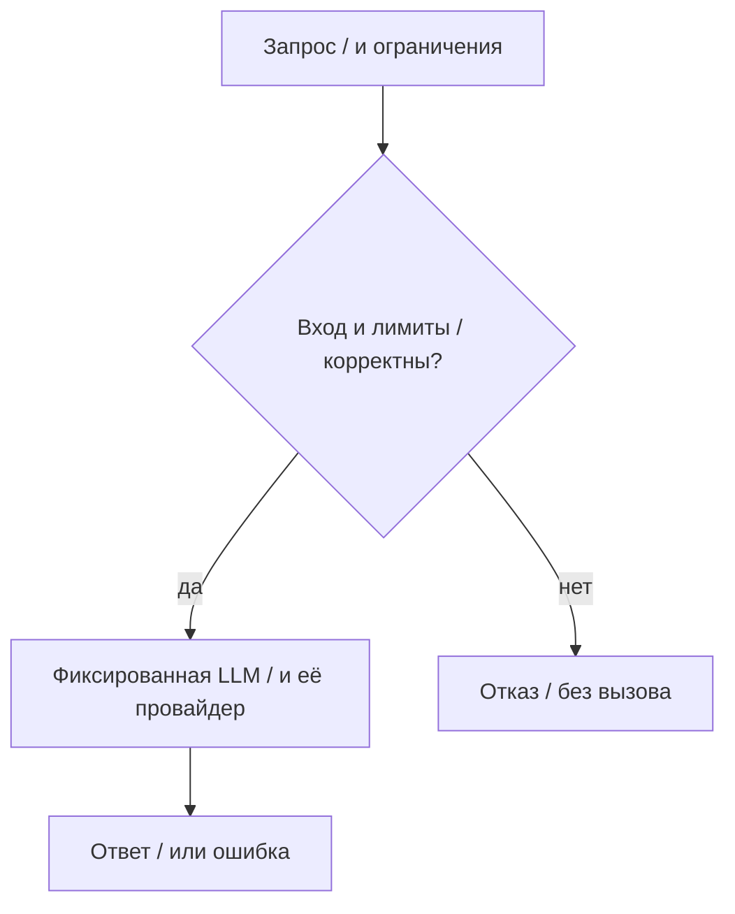
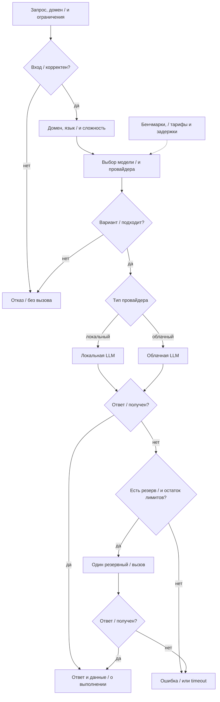

# Дизайн ML-системы — Smart LLM Router, MVP V1

- **Проект:** интеллектуальная маршрутизация между LLM.
- **Автор:** Лазарчик Михаил Павлович, ИТМО.
- **Версия:** V2, 14.11.2026.
- **Статус:** ДЗ №2 — выполненный EDA и проект этапов реализации.

Структура опирается на [шаблон Reliable ML](https://github.com/IrinaGoloshchapova/ml_system_design_doc_ru/blob/main/ML_System_Design_Doc_Template.md).
Разделы 1–2 описывают цели и методологию, разделы 3–4 — план пилота
и возможное внедрение.

В этой работе выполнен EDA закреплённых MGSM, Belebele и HumanEval; результаты
находятся в `reports/eda.md`. Маршрутизатор, вызовы LLM и пилот ещё не реализованы.
Все численные пороги приёмки —
предложения автора для обсуждения с ментором, а не измеренные результаты
или подтверждённые требования реального заказчика.

## 1. Цели и предпосылки

### 1.1 Зачем идём в разработку продукта?

- **Бизнес-цель (PO).** Дать разработчикам и владельцам LLM-приложений единый
  сервис, который автоматически подбирает готовую модель под запрос. Выбор
  между локальными и облачными провайдерами должен снижать расходы,
  сохраняя качество ответа и приемлемое время ожидания. Разработчику не нужно
  вручную выбирать LLM для каждого задания.
- **Почему автоматический подбор улучшает ситуацию (PO и DS).** Одна модель
  может хорошо решать задачи программирования, но уступать другой в математике
  или на другом языке. Роутер сопоставляет домен, язык и признаки сложности
  запроса с результатами бенчмарков, стоимостью и задержкой доступных моделей.
  Решение использует готовые LLM и правила выбора, без изменения весов моделей.
- **Критерии успеха итерации (PO).** Для будущего MVP предлагается снижение
  полной стоимости обработки не менее чем на 30% относительно фиксированной
  LLM при потере качества не более 0.02 по шкале [0, 1] и без роста latency
  p50/p95/p99. Учитываются облачные платежи, локальные вычисления и сам роутер.
  Это предварительные цели; определения метрик и порядок проверки — в разделах 2.4 и 3.

### 1.2 Бизнес-требования и ограничения

- **БТ (кратко).** Сервис принимает текст, необязательный домен задания,
  бюджет, дедлайн и лимит ответа. Если домен не указан, он определяется
  автоматически по правилам. Система выбирает подходящую LLM и разрешённого
  провайдера, возвращает ответ, причину выбора и сведения о времени и расходах.
- **Бизнес-ограничения (PO).** В первом MVP рассматриваются три готовые LLM,
  включая локальный и облачный варианты, русский и английский языки и три домена:
  общие вопросы, математика и Python. Вход — до 4096 токенов, ответ — до 512,
  общий дедлайн — 30 секунд, максимум две попытки; границы проверяются перед пилотом.
  При локальном режиме запросы не уходят в облако даже при резервном вызове.
  Используются несекретные задачи с разрешёнными условиями использования;
  бюджет прогонов и пригодность локального оборудования проверяются заранее.
- **Ожидаемый результат итерации.** Для ДЗ №2 — воспроизводимый EDA
  и конкретные этапы реализации в дизайн-документе. Для следующей итерации — работающий MVP с локальным
  и облачным провайдерами и отчёт о сравнении автоподбора с простыми стратегиями.
- **Бизнес-процесс пилота.** Приложение передаёт запрос в единый интерфейс;
  роутер учитывает домен, бенчмарки и ограничения, вызывает выбранную LLM
  и возвращает результат. На новых задачах проверяются качество ответов,
  задержки и расходы. Если подходящей модели нет, система явно отказывает.
- **Критерии успешного пилота и развитие.** Экономия подтверждается на сопоставимом
  потоке запросов при соблюдении ограничений на качество и скорость.
  Отдельно считаются токенная, полная и чистая экономия после внедрения.
  При подтверждении пользы можно расширять набор моделей и доменов;
  при отсутствии выигрыша сохраняется фиксированная стратегия.

### 1.3 Что входит в скоуп проекта/итерации, что не входит

- **Входит в скоуп MVP (DS):** реестр трёх готовых LLM, единый интерфейс
  локальных и облачных провайдеров, определение домена и языка, правила
  автоподбора по бенчмаркам с учётом сложности, цены и задержки. Предусмотрены
  одна резервная попытка в пределах общих лимитов, учёт расходов и времени,
  сравнение с фиксированной моделью и самым дешёвым допустимым вариантом.
- **Не входит в скоуп:** изменение весов моделей, RAG, агенты и вызовы
  инструментов, мультимодальность, история диалога, потоковая выдача
  и промышленное внедрение с высокой нагрузкой и SLA.
- **Качество кода и воспроизводимость (DS).** Настроены Ruff и pre-commit.
  Для экспериментов фиксируются задания, промпты, версии моделей и провайдеров,
  параметры генерации, правила выбора, тарифы и конфигурация оборудования.
  Итоговый набор не используется для настройки; фактические и оценочные расходы
  показываются раздельно.
- **Технический долг.** На первом этапе реестр и результаты хранятся в файлах,
  профили обновляются вручную, отчёты формируются локально. Нагрузочное
  тестирование, промышленный мониторинг, авторизация и масштабирование
  потребуются при переходе к реальному пользовательскому трафику.

### 1.4 Предпосылки решения

- **Данные.** Нужны одинаковые задания для сравнения моделей, эталоны или
  критерии приемлемого ответа, замеры задержек и расходы. Публичный диагностический корпус выбран и исследован в ДЗ №2 (раздел 2.3, этап 1).
  Конкретные endpoint и тарифы ещё выбираются; реального заказчика и трафика нет.
- **Основная гипотеза.** Модели различаются по качеству в доменах и языках,
  и часть запросов можно направить более дешёвой LLM без существенной потери
  качества. Это проверяется на бенчмарках; локальная модель не считается
  автоматически более дешёвой или быстрой.
- **Гранулярность и горизонт.** Решение принимается для одного запроса
  и конкретной модели у провайдера. Качество и задержка оцениваются на уровне
  ответа, экономический эффект — также за выбранный период работы сервиса.
- **Частота обновления.** Профили актуализируются перед пилотом и при смене
  модели, квантования, оборудования, тарифа или заметном изменении задержек.
  Для разных конфигураций запуска используются отдельные показатели.
- **Неопределённые задания.** Домен определяется по правилам, а не известен
  безошибочно. При неоднозначном домене или недостатке данных используется
  заранее выбранная фиксированная модель, если её провайдер и расходы допустимы;
  иначе возвращается отказ.

## 2. Методология

### 2.1 Постановка задачи

Система автоматически подбирает готовую LLM под домен задания и ограничения
клиента. На вход подаются текст, допустимые расходы, время ожидания и максимальный
размер ответа. Домен можно указать явно; если он не указан, система определяет
его по тексту. На выходе — ответ выбранной модели, сведения о провайдере
и причине выбора либо понятная причина отказа.

В рамках проекта используются правила маршрутизации и результаты бенчмарков.
Меняются правила и настройки выбора, а не веса моделей. Для каждой LLM заранее
собираются показатели качества по доменам и языкам, стоимость и задержка.
Локальный и облачный запуск одной модели учитываются отдельно, если их
конфигурации и показатели различаются.

**С чем сравниваем решение:**

| Подход | Как выбирается LLM | Зачем сравниваем |
| --- | --- | --- |
| Фиксированная модель — основной бейзлайн | Одна и та же основная LLM у заранее выбранного провайдера | Проверить сохранение качества и снижение расходов |
| Самый дешёвый допустимый вариант | Минимальная оценка стоимости запроса среди разрешённых моделей и провайдеров | Проверить, оправдан ли учёт качества |
| Доменный автоподбор — MVP | Правила сопоставляют домен, язык и сложность задания с результатами бенчмарков | Проверить пользу автоматического выбора по сравнению с одной фиксированной моделью |

Все подходы проверяются на одинаковых запросах и с общими ограничениями.
Пользователь не переключает стратегию при каждом обращении к MVP.

**Как работает автоподбор:**

1. Проверить текст и ограничения. Некорректный запрос отклоняется до вызова LLM.
2. Получить домен из запроса клиента или определить его по понятным правилам:
   например, конструкции Python и запрос на исправление кода указывают на
   программирование, а математические выражения и типовые формулировки —
   на математику. Правила проверяются на примерах; один признак не считается
   безусловным доказательством. Для неоднозначного задания домен остаётся неизвестным.
3. Определить язык и ориентировочную сложность по фиксированным признакам.
   Правила задаются заранее и одинаково применяются к бенчмаркам и новым запросам.
4. Исключить недоступные и запрещённые провайдеры, неподходящий размер контекста,
   варианты без актуальных замеров и варианты, не укладывающиеся в ресурсы.
5. По результатам бенчмарков найти модели с достаточным качеством для этого
   домена и языка. Для более сложных заданий правила могут требовать более
   высокого уровня качества. Пороги задаются до итоговой проверки.
6. Среди подходящих вариантов выбрать минимальную оценку стоимости запроса;
   при равной стоимости — меньшую измеренную задержку, затем стабильный ID.
7. Вызвать выбранную готовую LLM через адаптер локального сервера или облачного API
   и вернуть ответ с моделью, провайдером, причиной выбора, временем и расходами.

Если домен неизвестен или для группы задач недостаточно данных, используется
заранее выбранная фиксированная модель, только если её провайдер разрешён
и хватает ресурсов. Если подходящего варианта нет, возвращается отказ.
Доменный автоподбор не должен направлять запрос к случайной модели при отсутствии
профиля. Фактическое качество отдельного ответа заранее неизвестно.

Локальный провайдер — сервер готовой LLM на оборудовании пользователя или
в его инфраструктуре. Облачный провайдер — удалённый сервис с API.
Для роутера они имеют общий интерфейс запроса, ответа и ошибки, но разные
параметры подключения и способы оценки расходов. Если разрешена только
локальная обработка, ни основной, ни резервный запрос не отправляется в облако.

При техническом сбое разрешён один резервный вызов другой допустимой модели
или провайдера. Повторно учитываются остаток бюджета, общий дедлайн и список
разрешённых провайдеров. Неудачная попытка может иметь стоимость; она также
учитывается. Повторного вызова для проверки содержания ответа в MVP нет.

### 2.2 Блок-схема решения

Результаты бенчмарков и правила выбора готовятся заранее. Во время работы
система получает только новый запрос и сохранённые показатели; правильный
ответ ей неизвестен.

**Бейзлайн — фиксированная готовая LLM:**

Модель и провайдер фиксируются до итогового теста. Провайдер может быть
локальным или облачным. Для сравнения применяются те же ограничения и порядок
обработки технических сбоев, что у MVP: не более одной резервной попытки.
Основной и резервный варианты бейзлайна задаются заранее; схема показывает основной путь.

**MVP — автоподбор модели под домен задания:**

В блоке выбора проверяются и качество по домену, и ограничения ресурсов,
и разрешённость провайдера. Резервный вариант проходит те же проверки.
Поиск фиксированной модели для неизвестного домена входит в этот же блок.
Общий бюджет и дедлайн не начинаются заново; третьего вызова нет.
Получение ответа от API не означает, что его содержание проверено на правильность.
Для всех исходов сохраняются статусы, модели, провайдеры, число попыток,
время и расходы; полные тексты в эксплуатационные логи не записываются.

### 2.3 Этапы решения задачи

**Статус ДЗ №2.** Выполнены сбор закреплённого публичного снимка и EDA:
[отчёт](../reports/eda.md), [машинные результаты](../reports/eda_summary.json),
[код](../scripts/eda.py), [источники](../data/sources.lock.json).
Следующие этапы описывают конкретный план реализации. Ответы LLM, качество
маршрутизации, latency и экономия пока не измерены. В проекте не меняются веса LLM;
подготовка моделей означает настройку готовых endpoint и правил выбора.
В учебном проекте автор совмещает роли PO, DE, DS и MLE.

#### Этап 1. Подготовка данных

**Вход, состав и качество.** Выбран полный доступный срез en/ru из MGSM и Belebele
и английский HumanEval. Это 2 464 строки, 1 150 пар переводов и 902 группы
связанных примеров. Есть эталонные ответы, но нет пользовательского потока,
ответов реестровых моделей, таймингов, стоимости или меток истинной сложности.

| Сущность | Источник / наличие | Ресурс получения | Проверка качества |
| --- | --- | --- | --- |
| Задание, `task_id`; связанная группа, `group_id` | MGSM TSV, Belebele JSONL, HumanEval JSONL.gz; загружаются в локальный кеш `data/raw` | DE: фиксировать revision, SHA-256 и лицензию | Выполнена: обязательные поля, ключи, дубли, язык, длины и пары |
| Числовой эталон MGSM | Есть, 250 задач × 2 языка | DS: нормализация, проверка переводов | 8 строк требуют удаления разделителя тысяч; ответы пар совпадают |
| Эталон MCQ Belebele | Есть, индекс 1–4 для 900 вопросов × 2 языка | DS: проверить диапазон, варианты и пары | 4 строки с повторяющимися вариантами — карантин; нет противоречащих парных меток |
| Эталон Python | Есть, canonical_solution, test, entry_point для 164 задач en | DS: статический анализ; позже отдельный sandbox runner | AST всех эталонов/тестов разбирается; исполнение и полнота тестов не проверены |
| Новый development и закрытый test | Пока отсутствуют | Автор заданий + два проверяющих для спорных эталонов | План: независимая разметка и согласование расхождений |
| Ответ модели на задание | Пока отсутствует, будущая матрица `task × endpoint × repeat` | MLE: одинаковые генерационные условия | План: FK, статусы, полнота матрицы, usage и парность |

**Отдельная витрина признаков (план).** Ключ `task_id`: текст запроса,
`language_detected`, `domain_detected`, `domain_supplied`, длина по токенизатору endpoint,
наличие кода/формул, число строк, бюджет, дедлайн, список разрешённых провайдеров.
`source` и gold domain/language нужны для аудита, но не подаются в правила
распознавания; иначе формат benchmark подскажет правильный домен.
Версии правил и токенизатора обязательны. Для модели нельзя использовать эталон,
скрытые тесты, имя датасета, canonical_solution или показатели её будущего ответа.

**Отдельная витрина целевых переменных (план).** Ключ `(task_id, endpoint_id,
generation_config_hash, repeat)`: `acceptable ∈ {0,1}`, `raw_score`, `judge_status`,
`rubric_version`, `failure_reason`. Gold domain/language для проверки распознавания
хранятся отдельно от предсказанных. Метка приемлемости получается после ответа,
а не является заранее известной «правильной моделью». Таблица наблюдений хранит
ответ, status, usage по категориям, elapsed_ms, тарифную версию и все попытки.
Качество не измеренной модели — missing, а не ноль или отрицательный пример.

**Генерация и поступление.** Текущий сбор однократный, статический:
закреплённый URL → проверка upstream SHA-256 → gzip без изменения текста →
проверка локального SHA-256 → парсер → флаги качества → EDA.
Повторный запуск использует локальный кеш; первый загружает закреплённые файлы.
Сырые снимки исключены из Git; повреждённое содержимое вызывает ошибку.
Новая версия benchmark создаёт новую версию manifest и отчёта, не перезаписывает
эксперимент задним числом. MGSM-пары связаны позицией строки в закреплённых
параллельных файлах; длина и совпадение эталонов проверяются. Belebele-пары
связаны `(link, question_number)`, группа включает весь link и оба языка.
В HF-снимке есть date-like `ds`, различающийся у переводов: это не ключ группы.
Точные нормализованные дубли объединяются union-find. Семантические дубли требуют
дополнительной ручной/embedding-проверки только на development.

Для будущего пилота приложение пишет JSONL событий с request_id и версиями;
разрешённые запросы поступают регулярно, разметка — отдельными пакетами раз в неделю.
При изменении модели, квантования, сервера или промпта запускается новый benchmark;
замеры разных конфигураций не склеиваются в один профиль.

**Решения по EDA и риски.** Пустых условий, отсутствующих эталонов и точных
нормализованных дублей не найдено. Однако 73.1% строк относятся к пониманию текста;
RU Python отсутствует. General-QA представлен только чтением с выбором ответа.
Четыре неоднозначных MCQ исключаются до ручной проверки: остаётся 2 460 строк
диагностической оценки, с отдельным raw-отчётом. Восемь чисел нормализуются по
схеме MGSM. У cl100k_base медиана ru/en на паре — 2.325; реальную стоимость это
не определяет. Длина max=876 на этой шкале не проверяет границу в 4096 токенов.
В отчёте все ограничения связаны с решениями; длинные и смешанные запросы
нужно добавить отдельно. Нулевое число точных дублей не гарантирует независимость.

**Достаточность и дополнительный сбор.** Текущего объёма достаточно для EDA,
но не для приёмки шести срезов и небольшого допуска потери 0.02.
Стартовый план — 200 development + 1 000 закрытых test-заданий на каждый срез,
всего 7 200 новых строк. Приоритет — 200 development RU Python с новыми задачами,
проверенными переводами docstring и сохранением тестов; затем свободные общие
вопросы на обоих языках. Это план, не выполненный сбор и не гарантия мощности.
Уникальные оригиналы важнее количества переводов. При доле разногласий двух
стратегий 0.10 и 1 000 независимых парах SE разницы долей ≈0.01; односторонняя
95% граница ≈1.65 п.п. при нулевой разнице. После пилотной калибровки уточняются
доля разногласий, cluster design effect и нужное число независимых групп.

**Конфиденциальность.** Источники публичны и имеют лицензии (см. `data/README.md`),
но могут содержать имена и ссылки; отсутствие PII не доказано автоматическим аудитом.
Новые запросы могут включать персональные данные, ключи и коммерческие сведения.
До допуска в эксперимент требуются разрешение владельца, маскирование секретов,
проверка сохранения смысла и allowlist внешних провайдеров. Полные рабочие тексты
не публикуются в Git; эксплуатационные логи содержат только технические метаданные.
Экспериментальные тексты с ограниченным доступом хранятся отдельно, срок пилота
30 дней, затем удаление; для публичных benchmark в репозитории остаются ссылки, лицензии и контрольные суммы.
Режим local-only сохраняется при резервном вызове. Маскирование не заменяет
разрешение на передачу; до её получения внешние API для таких данных не используются.

**Результат этапа.** Для бейзлайна и MVP — один versioned-корпус, словарь сущностей,
отдельные признаки/эталоны, manifest зависимых групп и отчёт качества.
Для будущего MVP дополнительно нужен новый покрывающий шесть срезов corpus.
Переход: все обязательные ключи уникальны, эталоны доступны evaluator, пересечений
групп между фактическими частями нет, лицензии проверены; непокрытый срез блокирует
заявление об успехе по нему. Уже выполненная часть этапа — публичный снимок и EDA.

#### Этап 2. Подготовка прогнозных моделей

**Постановка и функция потерь.** В бейзлайне и MVP используются готовые LLM;
градиентное обучение и training loss отсутствуют. Подбираются конфигурация
генерации, профили и правила маршрутизации. Для политики π цель — минимизировать
`mean(C_full(π,x))` при `Q_baseline − Q_π ≤ 0.02`, допустимой задержке и ограничениях
по провайдеру, контексту и бюджету. Средняя потеря ответа — `L_answer=1−acceptable`;
она измеряет ошибку решения, но не оптимизируется backpropagation.
Качество контролируется ограничением, потому что произвольный коэффициент между
рублями и ошибками может скрыть неприемлемое ухудшение за экономией.

**ML-метрики.** Приемлемость бинарная, ошибки/таймауты/отказы дают 0;
публикуются micro и равновесное macro по шести `domain × language`, размеры,
парная разность с бейзлайном и интервалы. Отсутствующий срез не заменяется нулём
и не исключается молча из шестисрезового macro.
Диагностические метрики: MGSM exact-match конечного числа после строгого парсинга;
Belebele accuracy индекса 1–4; Python pass@1 одного заранее определённого ответа.
Для свободных общих ответов рубрика проверяет правильность, полноту и язык;
для математики/Python дополнительно проверяется язык пояснения, если оно требуется
промптом. Не требуем CoT: скрытые рассуждения не оцениваются.
Ошибки парсинга регистрируются отдельно и считаются неприемлемыми, а не выкидываются.

Распознавание домена оценивается macro-F1 и accuracy, неизвестный домен — abstain,
доля abstain и его ошибки показаны отдельно. Это вспомогательная метрика:
хороший классификатор не доказывает экономию. Latency p50/p95/p99, доля успешных
ответов в дедлайн, расходы всех попыток и стоимость приемлемого ответа связаны
с целью пользователя; точные определения сохранены в разделе 2.4.
У текущего EDA нет ответов моделей: значения этих метрик не подставляются.

**Схема валидации.** Текущие публичные наборы — внешняя диагностика;
Belebele upstream предназначает только для test, поэтому его не используем
для настройки порогов, промптов или классификатора. Колонки split в EDA —
демонстрация утечки, не фактический train/validation/test для обучения.
Новый корпус до прогонов распределяется по устойчивым группам оригинала,
перевода, общего passage и семейства шаблонов. В development (200/срез)
60% групп идут на профили, 40% на validation; на малом числе групп — внутренний
group-CV без доступа к закрытым 1 000/срез. На profile оцениваем качества endpoint,
на validation выбираем пороги и фиксированную LLM. На test один раз проверяем
зафиксированную политику. Если test использован для правок, он становится dev,
для повторного честного решения нужен новый holdout.

Стратификация учитывает домен/язык, но группа целиком остаётся в одной части;
несовпадение фактических долей публикуется. Имена источников и скрытые эталоны
не доступны router. Основной test выполняется без переданного gold domain;
сценарий с указанным доменом — отдельный верхний ориентир.
Доверительные интервалы считаются парным bootstrap по независимым группам,
например 10 000 повторов с seed=42, с сохранением ru/en-связей и пересчётом macro.
Для допуска потери используется односторонняя 95% верхняя граница;
для описательных сравнений — двухсторонние 95%. Повторы одной задачи не увеличивают
число независимых групп. Новые пользовательские данные делятся также по времени
и семье задачи, последние периоды резервируются под проверку drift.

**Бейзлайны и предобработка.** B0 — фиксированные основная LLM и резервный endpoint,
выбранные по development, не по test. B1 — самый дешёвый допустимый endpoint
без quality-фильтра (но с ограничениями безопасности, бюджета, контекста и времени).
У B0/B1/MVP одинаковы шаблоны по домену/языку, лимит ответа 512, общий deadline 30 c,
temperature=0 где поддерживается, максимум две попытки; параметры capability фиксируются.
Unicode/переносы приводятся к согласованному виду без изменения кода и математики.
System prompt, chat template и токенизатор версионируются для каждого endpoint.
Неизвестный домен вызывает заранее заданную фиксированную модель либо отказ.
Фиксированный бейзлайн при недопустимых ресурсах тоже отказывает: нельзя тайно
выдать ему больший бюджет или неограниченное число повторов.

**MVP.** Три слота: локальная лёгкая L1, локальная более сильная L2 и облачная C1.
Точные IDs/версии выбираются после проверки доступного оборудования, лицензии,
API и бюджета; отсутствие хотя бы локального и облачного вариантов блокирует
интеграционный пилот. В ДЗ №2 доступность не заявляется измеренной.
MVP определяет domain/language по правилам (клиентский domain можно передать),
сопоставляет с profile-качеством и выбирает минимальную полную стоимость среди
кандидатов, прошедших quality/resource-фильтры. Малые группы не дробятся по сложности.
При недостатке наблюдений профиль считается недоступным, а не «плохим».

**Подбор и развитие.** На validation сравниваются максимум 12 конфигураций:
quality-margin {0, 0.02, 0.05}, минимальный размер profile-группы {30, 100},
признак длины/кода {выключен, включён}. Пороги не гарантируют попадания в acceptance;
при широких интервалах используется fallback и добор данных. Профили используют
нижнюю Wilson-границу доли приемлемых ответов, не только point estimate.
Абляции: фиксированная модель → язык → язык+домен → длина/код; отдельно проверяется
реальная ошибка распознавания против gold-domain. После доказательства пользы
возможны TF-IDF+logistic regression для домена (cross-entropy, веса классов из train),
multilingual embeddings и модель `P(acceptable|request,endpoint)` (BCE и калибровка
на validation). Источником их меток станет полная матрица ответов, не LLM самооценка.
Это будущие итерации, не обязательное усложнение текущего rule-based MVP.

**Интерпретация и риски.** Для решения сохраняются определённый домен/язык,
профиль и его n/интервал, исключённые endpoint с причинами, оценка расходов,
fallback и версия правил. Разбираются все случаи потери против B0 на validation
и стратифицированные успешные случаи; ошибки разделяются на распознавание,
выбор модели, генерацию, evaluator и provider failure.
Проверяются чувствительность к опечаткам, смешанному языку и неоднозначному домену.
Contamination снижается свежим holdout; переобучение порогов — ограничением поиска;
ошибки разметки — слепой ручной перепроверкой; дрейф — версионированием и пересчётом.

**Результат этапа.** Зафиксированные B0/B1/MVP, evaluator, manifest частей,
промпты, политика, profile-таблица и протокол сравнения. Переход к пилоту требует
интервалов качества и полного учёта отказов/затрат; при отсутствии выигрыша
сохраняется B0. В ДЗ №2 подготовлен дизайн этого этапа, не результаты эксперимента.

#### Этап 3. Сопоставимый benchmark и оценка ответов

**Вход.** Допущенный корпус, три endpoint, generation_config и бюджет прогона.
Вместо чужих leaderboard-чисел строится собственная матрица на одних заданиях:
`task_id × endpoint_id × repeat`. Endpoint ID включает модель, версию, провайдера,
квантование и оборудование. Опубликованные scores используются для shortlist,
поскольку разные промпты/оценщики/нагрузка делают их напрямую несопоставимыми.

**Бейзлайн.** Проверка B0 на всех допущенных заданиях и unit-проверки evaluator
на правильном, неправильном, пустом и невалидном ответе. **MVP.** Для каждого
задания вызвать все endpoint, перемешать порядок endpoint/задач с seed=42,
разнести прогрев и основной прогон. Один основной ответ на задачу; три повтора
на фиксированном 10% development-срезе оценивают нестабильность, а не pass@3.
Сохранять time.monotonic-тайминги, usage, response/attempt IDs, finish_reason,
truncation, errors и billed/estimated стоимость. Неполная матрица не заполняется
нулевыми результатами; технически попытанный timeout имеет acceptable=0.

MGSM парсит выделенный конечный ответ в Decimal; разделители обрабатываются
по явно заданной локали, неоднозначные форматы дают parse_error. Belebele принимает
только один индекс 1–4, а не ищет случайную цифру в объяснении. Python проверяет
сигнатуру и тесты в отдельной песочнице без сети/секретов, read-only вход,
непривилегированный процесс, CPU/RAM/PID/time limits; обычный subprocess
не считается границей изоляции. Сбой runner отличается от провала решения.
Свободные ответы оценивают два проверяющих вслепую к имени модели на всём test
и минимум 20% development; расхождения разрешаются совместно, фиксируются agreement
и adjudication. LLM-as-judge возможен вспомогательно после проверки против людей,
но не выступает единственным ground truth.

**Риски и выход.** Неполные тесты, judge bias, 512-token truncation и запоминание
benchmark могут искажать quality. Отдельно публикуются такие статусы, язык,
источник, raw/filtered результаты; до безопасного runner Python-quality не заявляется.
Выход — versioned матрица, качество/usage/latency по endpoint и срезу,
лог оценки, без запуска скрытых тестов внутри prompt модели.

#### Этап 4. Ограниченная оптимизация маршрута и экономика

**Бейзлайн.** Фиксированная модель и минимальная оценка цены без quality-фильтра.
**MVP.** На каждый запрос сначала применяются жёсткие фильтры:
allowed providers/local-only, доступность, точный контекст, актуальность профиля,
остаток бюджета и времени. Затем quality-фильтр по domain/language и минимуму n.
Из допустимых выбирается минимум `estimated_full_cost`; tie-break — p95 профиля,
затем стабильный endpoint_id. Профиль свежий не более 7 дней в пилоте и немедленно
инвалидируется при изменении endpoint; тариф проверяется перед прогоном.
Для неоднозначного домена или пустого множества кандидатов — разрешённый B0
или `no_feasible_model`, без обхода ограничений.

Стоимость облачной попытки — сумма `tokens_category × price_category`; input/output,
cache и иные оплачиваемые категории не смешиваются. Резерв до вызова считается
по максимальному output и условиям endpoint. Неизвестная верхняя стоимость
запрещает использование endpoint при жёстком бюджете. Для локальной модели
GPU/CPU-время оценивается по согласованной полной часовой стоимости и загрузке,
простой учитывается на уровне периода; не начисляется одновременно дважды.
Сопровождение и роутер включаются в C_full, первичная интеграция отдельно в CapEx.
Цены и курсы versioned; нет фиксированных выдуманных тарифов.

Replay матрицы даёт качество выбранного ответа и расчётную стоимость,
но не full latency сервиса и не экономию с учётом настоящих retries.
Oracle, выбирающий лучший фактически полученный ответ, допустим только как
верхний ориентир, недоступный рабочей политике; его оценки не используются
для выбора модели на той же test-задаче.
Риски — недооценка output/retries, бесплатная локальная модель на бумаге,
устаревшие профили. Выход — versioned правила, журнал причин, Pareto-таблица
quality/cost/latency на validation и оценка общего бюджета перед вызовами.

#### Этап 5. Инференс, ограничения и резервный вызов

**Бейзлайн.** Единый адаптер основной и фиксированной резервной модели.
**MVP.** Адаптеры локального и облачного провайдера с одинаковыми статусами:
`ok`, `invalid_request`, `no_feasible_model`, `provider_error`, `timeout`.
Поля `/route`: request_id, prompt, optional domain, max_output_tokens,
deadline_ms, budget, allowed_providers, local_only. Ответ содержит answer,
endpoint_id, reason, policy_version, attempts, timings и billed/estimated cost.
Секреты задаются переменными окружения, пользовательский URL не становится endpoint.

Дедлайн начинается при получении запроса. После технической ошибки допускается
один резервный вызов, если оставшиеся бюджет и deadline покрывают новую попытку;
первая попытка может быть оплачена и продолжаться у provider после клиентского
timeout. При неизвестном списании её резерв не освобождается. В local-only
оба вызова локальные; при отсутствии разрешённой замены возвращается ошибка.
Успешный HTTP-ответ не означает правильность; автоматического вызова judge
для каждого пользовательского ответа в MVP нет.

Проверки граничных сценариев: пустой/слишком длинный запрос, нулевой бюджет,
неизвестный язык, stale profile, недоступный API, exhausted deadline,
вторая ошибка и запрещённое облако. Нарушение бюджета/local-only блокирует пилот.
Риски — циклические retries, race доступности, утечка ключей. Выход — рабочий
конвейер и интеграционный протокол, совместимый с журналом эксперимента.

#### Этап 6. Независимая проверка, пилот и мониторинг

**Бейзлайн.** Зафиксированные B0 и B1 на новом закрытом корпусе.
**MVP.** Тот же корпус, сначала replay качества, затем отдельный живой прогон
с перемешанным порядком стратегий и равной нагрузкой. Acceptance — раздел 3.2:
полная экономия ≥30%, верхняя односторонняя граница потери quality ≤0.02,
потеря по каждому срезу ≤0.05, отсутствие роста p50/p95/p99 и нарушений лимитов.
Недостаточное покрытие или широкий интервал означают «не доказано», не успех.
Для квантилей планируется не менее 10 000 живых запросов на стратегию с повторами
в разные интервалы времени; повторения не считаются новыми независимыми задачами
для quality. Cold/warm и successful/all outcomes показываются отдельно.

В пилоте наблюдаются доли domain/language, unknown/fallback, длины, доли endpoint,
ошибки, полные расходы и latency; качество — по еженедельной слепой размеченной
выборке и после смены модели/политики. Новый состав сам по себе не доказывает
ухудшение качества, но запускает дополнительную разметку. При потере допуска
откатываемся на B0 в пределах разрешённых ресурсов; при нарушении local-only
или бюджета останавливаем вызовы. Владелец решений — автор проекта.
Выход — таблица B0/B1/MVP с n, интервалами и версиями, журнал ошибок,
решение go/no-go и проверяемый сценарий отката. Пилот в ДЗ №2 не выполнен.

### 2.4 Метрики и сравнение с бейзлайном

Измеряются три результата: изменение качества ответов, скорости и расходов.
Для каждой метрики в отчёте показываются **фиксированная модель → автоподбор →
разница**, единица измерения и размер выборки. Самый дешёвый допустимый вариант
остаётся дополнительной точкой сравнения. Текущих измерений пока нет.

**Качество ответов LLM**

Одинаковая рубрика применяется к ответам всех стратегий: правильность, полнота
и язык ответа; для математики и Python используются также эталоны и тесты
из раздела 2.3. При ручной проверке название выбранной модели скрывается.

| Метрика | Как считаем | Роль |
| --- | --- | --- |
| Доля приемлемых ответов, [0, 1] | Доля запросов с приемлемым ответом; ошибки, таймауты и отказы получают 0. Основной итог — среднее по шести группам «язык × домен» с равными весами | Главный показатель качества |
| Разница качества, процентные пункты | Качество автоподбора минус качество фиксированной модели, умноженное на 100; положительная разница означает улучшение | Показать выигрыш или потерю после маршрутизации |
| Качество по доменам и языкам | Те же доли и разницы отдельно для ru/en, общих вопросов, математики и Python | Не скрыть ухудшение в отдельной группе за общим средним |
| Победы / ничьи / поражения | По каждой паре ответов на один запрос: приемлемый против неприемлемого — победа; одинаковые оценки — ничья; обратный случай — поражение. Доли считаются по всем запросам | Показать, на какой доле заданий поменялось качество |
| Определение домена | Доля верно определённых доменов среди всех запросов без готового указания домена; неизвестный домен считается ошибкой. Его доля также показывается отдельно | Диагностика правил, а не замена оценки ответов LLM |

Основная метрика качества лежит в диапазоне [0, 1]. Потеря 0.02 соответствует
двум процентным пунктам, а не относительному снижению на 2%.
Разница качества оценивается на одних и тех же заданиях с доверительным интервалом.
Улучшение правил определения домена само по себе не доказывает улучшения ответов.

**Скорость ответа и надёжность**

Полная задержка измеряется в миллисекундах от приёма запроса системой до полного
ответа или конечной ошибки. В неё входят определение домена, выбор модели,
ожидание ресурсов, сеть, генерация и резервный вызов, если он понадобился.

| Метрика | Что показывает | Сравнение |
| --- | --- | --- |
| Latency p50 | Медианная задержка: примерно половина запросов завершается не дольше этого времени | Значение бейзлайна, автоподбора и разница в мс |
| Latency p95 | Задержка, в пределах которой завершается примерно 95% запросов | Те же значения и разница в мс |
| Latency p99 | Задержка, в пределах которой завершается примерно 99% запросов; характеризует редкие долгие ожидания | Те же значения и разница в мс, с размером выборки и неопределённостью |
| Накладное время маршрутизации | Время определения домена и выбора модели; отдельно публикуются p50/p95/p99 | Проверить, не съедает ли сам роутер выигрыш во времени |
| Таймауты, технические ошибки и отказы | Доля каждого исхода среди всех входных запросов; отдельно — доля успешных ответов в пределах дедлайна | Не считать быстрый отказ улучшением скорости |

Разница задержки считается как **автоподбор минус бейзлайн**: отрицательная
разница означает ускорение. Для удобства также показывается ускорение в процентах
от задержки бейзлайна, если она больше нуля. Разница p95/p99 — это разность
квантилей двух серий, а не квантиль попарных разностей.
Квантили считаются отдельно для всех завершённых запросов и для успешных ответов.
Таймаут завершает наблюдение ошибкой; он не превращается в успешный ответ за 30 секунд.

Нагрузка, ограничения генерации и режим кеша должны быть сопоставимы;
для всех стратегий применяется один и тот же способ расчёта квантилей.
Холодный запуск локальных моделей и прогретый режим показываются раздельно.
Для всех квантилей публикуется число наблюдений; для p99 особенно важны достаточный
объём и разброс повторных прогонов. На малой выборке p99 отмечается как
предварительная оценка и не используется для уверенного заявления о выполнении цели.

**Экономические метрики**

Цены приводятся к одной валюте; тарифы и, при необходимости, курс пересчёта
фиксируются на дату расчёта. Учитываются все попытки, включая оплаченные ошибки.
Известные списания и оценочные расходы показываются раздельно.

| Метрика | Как считаем | Роль |
| --- | --- | --- |
| Потраченные токены | Входные и выходные токены по каждой попытке, модели и провайдеру; дополнительные оплачиваемые категории также учитываются | Объяснить, на что израсходован бюджет |
| Стоимость токенов и её разница | Стоимость оплачиваемых категорий по соответствующим тарифам; показываются сумма, цена на запрос и разница «бейзлайн минус автоподбор» в деньгах и процентах | Измерить изменение расходов на API |
| Полная стоимость обработки | Облачные вызовы + стоимость локальных вычислений + работа роутера и сопровождение; без двойного учёта. Показываются сумма и среднее на один входной запрос, также цена 1000 запросов | Оценить общую себестоимость, а не только токены |
| Стоимость приемлемого ответа | Полные расходы на весь размеченный набор, включая ошибки, делённые на число приемлемых ответов; при отсутствии таких ответов показатель не определён | Не маскировать ухудшение качества низкой ценой |
| Общая экономия за период | Сколько стоила бы фиксированная стратегия на том же объёме и составе запросов минус полные текущие расходы автоподбора; сумма и процент от расходов бейзлайна | Оценить эффект после ввода решения, например за месяц |
| Накопленная чистая экономия | Общая экономия с момента ввода минус разовые затраты на подготовку, первоначальные бенчмарки и интеграцию | Проверить, покрывает ли эффект затраты на внедрение |

Процент экономии — **(расходы бейзлайна − расходы автоподбора) /
расходы бейзлайна × 100%**. При нулевых расходах бейзлайна показывается только
абсолютная разница. Отрицательная экономия означает дополнительные затраты.
Количество токенов и их цена не взаимозаменяемы: модели могут иметь разные
тарифы и токенизаторы. Для локального провайдера без токенного тарифа расходы
на API отмечаются как отсутствующие, а затраты CPU/GPU учитываются в полной стоимости.

Условный пример расчёта, **не результат эксперимента**: на одинаковом потоке
все 100 денежных единиц расходов бейзлайна приходятся на API, а автоподбор
стоит 60 за API, 20 за локальные вычисления и 5 за роутер.
Экономия на токенах составляет 40%, а полная экономия —
15 единиц, или 15%. Если разовая подготовка стоила ещё 10 единиц, накопленная
чистая экономия за этот период равна 5 единицам.

На пилоте рассчитывается оценка экономического эффекта. После ввода используются
фактические расходы за выбранный период, а стоимость фиксированного выбора
оценивается по сопоставимой контрольной выборке. Эта база и неопределённость
расчёта указываются явно. Простое сравнение счетов «до» и «после» при разном
числе запросов или другом составе доменов не доказывает экономию от роутера.
Разовые затраты не включаются повторно в текущие расходы.

**Главный проверяемый результат:** достаточно ли снизились полные расходы при
допустимой разнице качества и задержек p50/p95/p99. Экономия только на токенах
не считается успехом, если общие расходы выросли или качество вышло за ограничения.

## 3. Подготовка пилота

### 3.1 Способ оценки пилота

Сравниваются доменный автоподбор, фиксированная модель и самый дешёвый допустимый
вариант. Состав метрик и правила расчёта заданы в разделе 2.4.
Все стратегии обрабатывают один зафиксированный набор новых несекретных задач
с одинаковыми инструкциями, лимитами ответа и разрешёнными провайдерами.
Основной прогон проверяет автоматическое определение домена; сценарий с явно
указанным доменом показывается отдельно.

Фиксированная модель выбирается по качеству на части данных для настройки,
до итогового теста. Основное сравнение проводится при ограничениях, в которых
она допустима. Недостаточный бюджет и другие причины отказа проверяются отдельно.
Качество и разницы публикуются по шести группам «язык × домен», а также
по локальным и облачным вариантам. Доверительный интервал разницы качества
оценивается парным bootstrap по группам задач с сохранением языковых и доменных срезов.

Офлайн-матрица ответов используется для оценки качества и расчётных расходов
выбранных маршрутов. Полная задержка p50/p95/p99 и фактические расходы резервных
вызовов измеряются отдельным живым прогоном с перемешанным порядком стратегий,
одинаковой нагрузкой и указанным режимом прогрева. Сохранённые задержки
из бенчмарков не выдаются за измерение работающего конвейера.

Итоговый отчёт содержит для каждой метрики колонки «бейзлайн», «автоподбор»,
«разница», размер выборки и неопределённость. Пока измерений нет, значения
помечаются «не измерено», а не заполняются нулями. Если данных недостаточно
для вывода о качестве или p99, результат считается неопределённым.

### 3.2 Что считаем успешным пилотом

| Показатель | Предварительный критерий | Способ проверки |
| --- | --- | --- |
| Полные расходы | Экономия не менее 30% относительно фиксированной модели при одинаковом потоке | Учитывать API, локальные ресурсы, роутер и все попытки; экономию на токенах показывать отдельно |
| Качество | Потеря относительно фиксированной модели не более 0.02 по шкале [0, 1] | Парное сравнение на закрытом test и односторонняя 95% верхняя доверительная граница потери не выше 0.02 |
| Качество по срезам | Точечная потеря не более 0.05 в каждом из шести срезов | Показать размер каждого среза и интервалы; малый объём данных означает предварительный вывод |
| Полная задержка | p50, p95 и p99 не выше соответствующих значений фиксированной модели | Живой прогон при одинаковых условиях; для p99 указать объём и неопределённость, при нехватке данных не объявлять цель достигнутой |
| Время выбора модели | p95 не более 100 мс; также публикуются p50 и p99 | Замер на указанном CPU при одном одновременном запросе, без времени LLM |
| Надёжность | Доля ошибок не выше фиксированной модели более чем на 0.01 | Учитывать таймауты, отказы и исчерпание бюджета на одном наборе |
| Ограничения | Ни одного вызова, нарушающего резерв бюджета или число попыток | Проверки граничных случаев и ошибок с подменённым провайдером |

Доменный автоподбор принимается при выполнении критериев и полезном выигрыше
относительно фиксированного выбора. При отсутствии статистически убедительного результата
фиксируется неопределённость, проводится пересмотр данных или сохраняется
простая стратегия. A/B-тест на пользователях и промышленное внедрение
потребуют новой итерации и здесь не обещаются.

### 3.3 Подготовка пилота

До платных вызовов выбираются доступные версии LLM, проверяются лицензии данных,
фиксируются рубрики и рассчитывается бюджет всего эксперимента, включая разметку.
Сначала небольшой калибровочный прогон проверяет реалистичность затрат и лимитов.
При недостаточной мощности теста потребуется увеличить выборку либо признать
ограниченность вывода. В отчёте фиксируются параметры облачных API, локального
сервера, оборудования и конфигурации моделей. Проверяются успешные вызовы
обоих типов провайдеров, обработка их ошибок и соблюдение локального режима.

## 4. Внедрение

Раздел описывает план следующей итерации; промышленный деплой в ДЗ №2 не выполняется.

### 4.1 Архитектура решения

Первый MVP — Python-процесс с проверкой запросов, определением домена по правилам,
таблицей результатов бенчмарков, правилами автоподбора и адаптерами провайдеров.
Общий интерфейс адаптера приводит локальный сервер LLM и облачный API
к одинаковому формату запроса, ответа и ошибки. В реестре сохраняются модель,
версия, провайдер, тип запуска и ограничения; показатели качества, расходов
и задержки привязаны к конкретной конфигурации.
Правила и профили хранятся в файлах, результаты экспериментов — в JSONL/таблицах.
Отдельные микросервисы и БД для первого пилота не требуются.

### 4.2 Инфраструктура и масштабируемость

Маршрутизатор работает на CPU. Локальный провайдер использует оборудование
пользователя или его инфраструктуру; достаточность памяти и производительности
проверяется до включения модели в реестр. Облачный провайдер доступен по сети
и зависит от тарифов, квот и доступности удалённого API.
Для локальных вариантов фиксируются оборудование, параметры модели и запуска;
для облачных — версия модели, тариф и условия измерения задержки.
Масштабирование и нагрузочные испытания следуют после пилота
на одном одновременном запросе.

### 4.3 Требования к работе системы

Общий дедлайн — 30 секунд, максимум две попытки. Контролируются p50/p95/p99
полной задержки и доля таймаутов по разделу 2.4. Резервный вызов использует
оставшееся время и бюджет. Неактуальные профили исключаются из выбора.
Предварительные показатели задержки — критерии эксперимента, а не production SLA.

**Проверяемые сценарии:**

- Если вход пустой, параметры некорректны или размер превышает лимит,
  возвращается `invalid_request` без вызова провайдера.
- Если домен задания определён, выбирается самый дешёвый допустимый вариант
  с достаточным качеством по бенчмаркам для этого домена и языка.
- Если домен указан клиентом, правила используют его; если не указан —
  определяют автоматически и отражают результат в причине выбора.
- Если уверенного выбора нет, используется фиксированная модель при достаточных
  ресурсах; иначе возвращается `no_feasible_model`.
- Для неподдерживаемого языка, неизвестного или неоднозначного домена
  применяется тот же путь фиксированной модели; соответствующие запросы отмечаются
  отдельно от шести основных срезов и не входят в заявления о качестве на них.
- Локальный сервер и облачный API возвращают ответы через общий интерфейс.
- В локальном режиме ни основной, ни резервный вызов не уходит в облако.
- При недоступности провайдера допускается только одна замена в пределах
  остатка бюджета, времени и списка разрешённых провайдеров; дедлайн не начинается заново.
- Метаданные показывают все попытки, статус и известную либо зарезервированную
  стоимость. Полные запросы и ответы не попадают в эксплуатационные логи.

### 4.4 Безопасность системы

Ключи облачных и защищённых локальных API передаются через переменные окружения
и не записываются в Git. Запросы направляются только на настроенные адреса
разрешённых провайдеров; произвольный адрес из текста задания не используется.
Сгенерированный Python-код исполняется для оценки только в изолированной среде
без сети и секретов, с ограничениями CPU, памяти и времени.
До открытия API внешним пользователям потребуются авторизация и лимиты запросов.

### 4.5 Безопасность данных

В пилоте используются только несекретные задачи. Настройки определяют,
разрешено ли отправлять запросы в облако; резервный вызов соблюдает те же ограничения.
Эксплуатационные логи содержат ID запроса, модель, провайдера, определённый домен,
версию правил, статусы, входные и выходные токены по каждой попытке,
известные либо оценочные расходы, начало и завершение запроса;
полные тексты запросов и ответов в них не сохраняются. Данные экспериментов
публикуются только при разрешённых условиях использования.
Автоматическая фильтрация персональных данных не заявляется реализованной.

### 4.6 Издержки

Для облачных API учитываются оплачиваемые токены и возможные повторы.
Для локального сервера оценивается стоимость вычислительного времени,
включая содержание оборудования и энергозатраты, с указанной методикой расчёта.
Расходы на оценку ответов и работу самого роутера показываются отдельно.
Работа роутера включается в полную стоимость обслуживания; разовая подготовка
и первоначальные бенчмарки — в затраты на внедрение. Повторяющиеся расходы
на контроль качества и сопровождение учитываются за соответствующий период.
Токенная, полная и накопленная чистая экономия рассчитываются по разделу 2.4.

До вызова рассчитывается верхняя оценка расходов по лимиту генерации,
общему времени и условиям конкретного провайдера. Вариант без определимой
оценки не допускается к бюджетно ограниченному вызову. Тарифы, допущения
по локальным затратам и месячная оценка появятся после выбора оборудования,
провайдеров и профиля нагрузки.

### 4.7 Точки интеграции

Планируется единый интерфейс `POST /route`: текст, необязательный домен,
бюджет, дедлайн и лимит ответа на входе; ответ, выбранная LLM, провайдер,
определённый домен, причина выбора, попытки, время и расходы на выходе.
Если домен не передан, срабатывает автоматическое определение по правилам.
Настройки сервиса задают допустимых провайдеров и режим локальной обработки.
Адаптеры обеспечивают вызовы локального сервера и облачного API;
конкретные системы и endpoint пока не реализованы.

### 4.8 Риски

| Риск | Последствие | Предлагаемая мера |
| --- | --- | --- |
| Ошибки в оценках качества или определении домена и языка | Выбор неподходящей LLM и ухудшение ответа | Единые критерии оценки, ручная проверка спорных примеров; для неоднозначного домена — фиксированная модель в пределах ограничений |
| Устаревшие показатели модели или провайдера | Выбор по неверным данным о качестве, расходах или задержке | Фиксировать версию и конфигурацию; обновлять замеры при смене модели, оборудования или тарифа |
| Недоступность или перегрузка провайдера | Ошибка или превышение времени ожидания | Проверять доступность, учитывать локальные ресурсы и облачные квоты; использовать общий таймаут и разрешённый резерв |
| Недооценка расходов, включая неудачные и резервные вызовы | Превышение бюджета запроса | Проверять остаток бюджета перед каждой попыткой и учитывать возможное списание за первый вызов; максимум две попытки |
| Отправка запроса в облако при локальном режиме | Нарушение выбранного способа обработки данных | Проверять разрешённых провайдеров для основного и резервного вызовов; отдельно проверять локальный режим |

**Открытые решения перед реализацией:**

1. Какие три готовые LLM и локальные/облачные провайдеры доступны по условиям использования и ресурсам?
2. Как дополнить исследованный корпус RU Python и свободными общими вопросами и получить новый закрытый test?
3. Какие правила определения домена и сложности, рубрики качества и минимальные пороги используются?
4. Подтверждаются ли пороги 30%, 0.02 и 100 мс после калибровки, и достаточно ли данных?
5. Как оценивать стоимость локального инференса и укладываются ли прогоны в согласованный бюджет?

Эти решения нужны перед запуском экспериментов. ДЗ №2 содержит EDA и план,
а не результаты работающих интеграций или пилота.

## Источники

- [Reliable ML: шаблон дизайн-документа](https://github.com/IrinaGoloshchapova/ml_system_design_doc_ru/blob/main/ML_System_Design_Doc_Template.md) — структура разделов и требование показать бейзлайн на схеме.

- [MGSM](https://github.com/google-research/url-nlp/tree/main/mgsm), [Belebele](https://github.com/facebookresearch/belebele), [HumanEval](https://github.com/openai/human-eval) — первичные benchmark и описание формата.
- [Выполненный EDA](../reports/eda.md) — измерения, визуализации, ограничения и принятые решения ДЗ №2.
