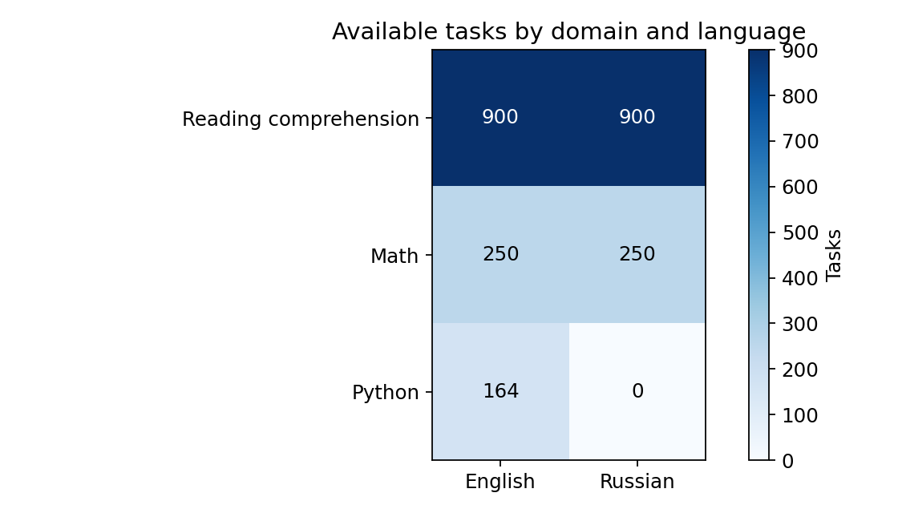
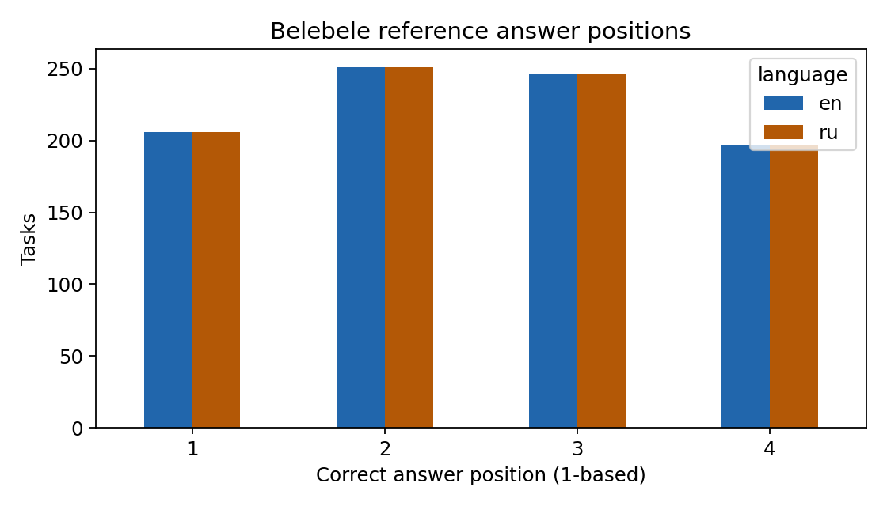
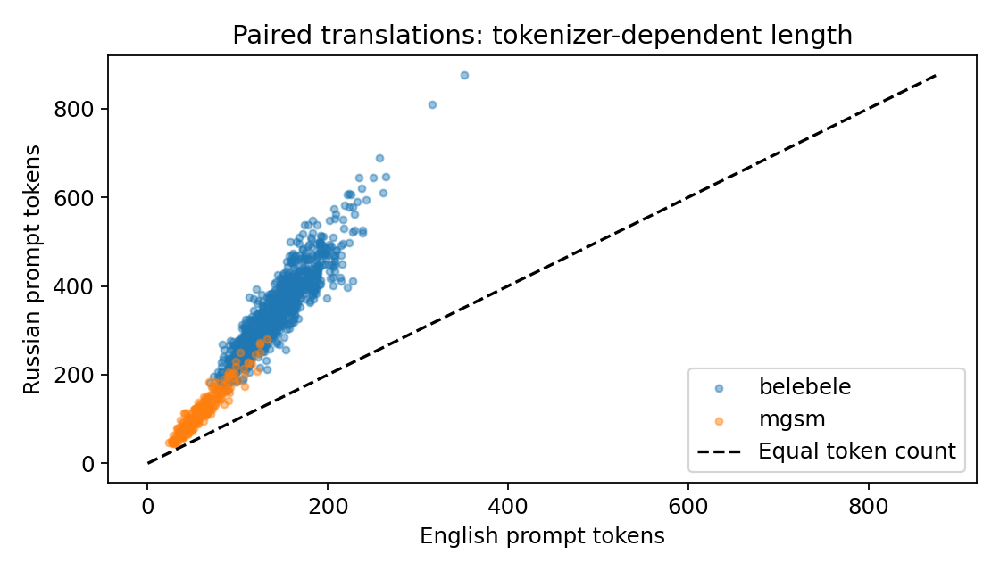

# EDA — Smart LLM Router

Дата снимка: **14.11.2026**. Анализ выполнен на реальных публичных данных,
без вызовов LLM и без исполнения Python-кода из датасета.
Машинные результаты: [JSON](eda_summary.json), [метаданные заданий](tables/task_metadata.csv),
[длины](tables/lengths.csv), [источники и SHA-256](../data/sources.lock.json).
Все графики ниже построены скриптом [scripts/eda.py](../scripts/eda.py).

## 1. Вопросы анализа и происхождение

Проверяем, достаточно ли данных для сравнения роутера с фиксированной LLM
по языку и домену, пригодны ли эталоны для автоматической оценки,
как длины влияют на ограничения контекста и какие зависимости испортят валидацию.
Единица наблюдения — **задание на одном языке**. Связанная группа объединяет
переводы одного задания, вопросы к одному тексту и нормализованные точные дубли.

| Источник | Что загружено | Объём | Роль и ограничение |
| --- | --- | ---: | --- |
| [MGSM, Shi et al.](https://github.com/google-research/url-nlp/tree/main/mgsm) | Полные `mgsm_en.tsv` и `mgsm_ru.tsv`, 250 общих задач | 500 | Математика с числовым ответом; школьные задачи, не вся математика |
| [Belebele, Bandarkar et al.](https://huggingface.co/datasets/facebook/belebele) | Полные `eng_Latn` и `rus_Cyrl`, 900 общих вопросов | 1 800 | Понимание текста с четырьмя вариантами; ограниченный прокси домена «общие вопросы» |
| [HumanEval, Chen et al.](https://github.com/openai/human-eval) | Полный `HumanEval.jsonl.gz` | 164 | Английские задачи Python, эталонная функция и тесты; не разработка целых проектов |

Источники выбраны из-за ru/en-пар и проверяемых ответов. Произвольная выборка
первых N строк не используется. Версии: MGSM `452a21ad3dae5668c06ceeac21ff073e1e40f9be`,
HumanEval `b9453e8f1865df0a0057a1383767caa400acfbcf`,
Belebele HF `7899cdfa4e1e0d733fd77c848e2c273cb1d32be2`.
В lockfile закреплены URL, размеры и хеши исходных и сжатых файлов.
Локальный кеш содержит около 0.56 МБ сжатых исходников; в Git публикуются
код загрузки, закреплённые ссылки и контрольные суммы. Перед первым EDA нужно
выполнить `python scripts/fetch_data.py`.
Лицензии и атрибуция находятся в [data/README.md](../data/README.md).

## 2. Покрытие и независимость

| Домен | English | Русский | Всего |
| --- | ---: | ---: | ---: |
| Понимание текста — прокси общих вопросов | 900 | 900 | 1 800 |
| Математика | 250 | 250 | 500 |
| Python | 164 | **0** | 164 |
| Всего | 1 314 | 1 150 | **2 464** |



**Вывод.** Покрыты пять из шести целевых срезов. На этих данных нельзя заявить
качество русского Python или успех всего шестисрезового MVP. 73.1% строк — Belebele:
обычное среднее будет отражать преимущественно понимание текста. В диагностике
нужны результаты по срезам, а шестисрезовое macro-average до сбора RU Python не определено.


Есть **1 150 пар переводов**, но всего **902 консервативные группы зависимости**:
488 текстов Belebele, 250 задач MGSM и 164 задачи HumanEval.
Два перевода не удваивают число независимых задач. Два вопроса к одному тексту
тоже нельзя разнести между настройкой и проверкой. При bootstrap пересэмплируется
вся группа с сохранением ru/en-пар; размер 2 464 не используется как размер
независимой выборки. Группировка не доказывает отсутствие смысловых near-duplicates.

## 3. Качество и разметка

| Проверка | Результат | Что делать |
| --- | ---: | --- |
| Пустые условия, отсутствующие эталоны | 0 / 0 | Проверять при каждой загрузке |
| Повторяющиеся task_id | 0 | Ошибка загрузки при нарушении |
| Повторяющиеся нормализованные полные условия | 0 | NFKC, пробелы, регистр; это не семантическая дедупликация |
| Несовпадение ответов между ru/en-парами | 0 из 1 150 | Не заменяет проверку корректности перевода |
| Невалидный тип/диапазон эталона после нормализации | 0 | Проверять числовой ответ, индекс 1–4, синтаксис эталона и тестов |
| Числовые ответы с разделителем тысяч | **8 строк, 4 пары MGSM** | Нормализовать `2,125` → `2125`; не считать запятую десятичной автоматически |
| Повторяющиеся варианты внутри MCQ | **4 строки, 2 пары Belebele** | Карантин до ручной проверки, одинаково для всех стратегий |

Изначальный строгий парсер считал 8 числовых ответов ошибочными.
Это проблема формата, а не неправильная разметка. Исходники сохранены без исправлений;
нормализация применяется в evaluator по известной схеме MGSM.
Четыре MCQ с повторяющимися вариантами помечены `duplicate_options` в метаданных.
Для очищенной диагностической оценки остаётся **2 460 заданий**: 898+898 Belebele,
250+250 MGSM, 164 HumanEval. Графики описывают исходные 2 464 строки;
в будущем отчёте нужны raw и filtered результаты с явными знаменателями.

Все 164 эталонные программы и тестовые блоки HumanEval синтаксически разбираются.
Число AST-узлов `assert`: min 1, median 7, max 26. Это статическая характеристика,
не число тестовых входов и не доказательство полноты тестов. Никакой код не исполнялся.
Репозиторий исходного harness помечен upstream как неподдерживаемый;
его нельзя использовать как готовую безопасную песочницу.



Правильные позиции в каждом языке: **206 / 251 / 246 / 197**.
Постоянный ответ «2» дал бы 251/900 = **27.9%**, случайный равномерный — ожидаемые 25%.
Это диагностика разметки, не результат LLM. Позиции умеренно несбалансированы;
нужны контроль без текста, неизменный порядок вариантов и отдельный stress-test
с перестановкой вариантов и соответствующим переносом эталона.

## 4. Длины, язык и ограничения контекста

Для сравнения используется **cl100k_base, tiktoken 0.12.0**, без system prompt
и chat template. Это единая диагностическая шкала, а не токенизатор всех будущих моделей.
Belebele включает passage, вопрос и четыре варианта; MGSM — условие;
HumanEval — исходный prompt с сигнатурой и docstring. Эталоны в prompt не добавляются.

| Источник / язык | min | median | p95 | max |
| --- | ---: | ---: | ---: | ---: |
| Belebele / en | 62 | 142 | 206 | 351 |
| Belebele / ru | 113 | 338 | 497 | 876 |
| MGSM / en | 23 | 55 | 102.1 | 132 |
| MGSM / ru | 44 | 108 | 206.65 | 280 |
| HumanEval / en | 38 | 117 | 270.1 | 391 |


**Вывод.** 34 задания превышают 512 диагностических токенов; ни одно не превышает
4096, max=876. Нельзя переносить это на реальный поток или реестровые модели:
нет длинных пользовательских запросов, служебных сообщений и истории.
Перед вызовом считаем полный prompt токенизатором конкретного endpoint,
проверяем `input + max_output <= context_window`; условие и тесты не обрезаем молча.
Длина сама по себе не считается истинной сложностью: меток сложности в корпусе нет.



Медиана отношения `tokens_ru / tokens_en` на 1 150 парах — **2.325**.
Парный анализ отделяет язык от разного состава задач. При этом результат зависит
от токенизатора: утверждение «русский всегда в 2.3 раза дороже» неверно.
Будущие профили стоимости разделяются по языку, модели, провайдеру и версии.
Во всём снимке 506 219 диагностических входных токенов; три полных прохода
дали бы 1 518 657 входных токенов на этой шкале. Выходные токены, ошибки, повторы,
служебный контекст, локальные ресурсы и реальные тарифы здесь не измерены.
Денежная экономия и latency по этим данным не вычисляются.

## 5. Проверка схемы разбиения


Воспроизводимый иллюстративный эксперимент: SHA-256 от ID с seed=42 назначает
части с вероятностями 60/20/20. При независимом назначении строк **565 групп**
попадают в разные части; в них **1 852 строки**. При назначении по `group_id`
пересечений нет. Фактические размеры сохраняются в [illustrative_splits.csv](tables/illustrative_splits.csv);
они не обязаны точно равняться 60/20/20 из-за размера групп.

**Это исследование утечки, а не разрешение обучаться на Belebele.** Upstream
предназначает Belebele только для тестирования: весь набор остаётся внешним
диагностическим benchmark. Метки `grouped_split` в CSV демонстрируют алгоритм
и не используются для настройки модели или роутера. На открытых MGSM/HumanEval
также не заявляется честная оценка незнакомых LLM задач: возможна контаминация.
Для выбора правил и окончательного acceptance-test планируется отдельный корпус
из новых заданий с зафиксированными ролями и группами (дизайн-документ, этап 2).

## 6. Риски, достаточность и принятые решения

| Наблюдение / ограничение | Последствие для роутера | Решение |
| --- | --- | --- |
| RU Python отсутствует | Нет оценки шестого среза | Сначала добавить не менее 200 новых RU Python для development; переводить и проверять тесты вручную, переводы держать вместе |
| General представлен только reading MCQ | Не проверены свободные ответы и реальные общие вопросы | Добавить новые ru/en открытые вопросы с рубрикой правильности, полноты и языка |
| 902 группы вместо 2 464 независимых задач | Узкие row-bootstrap интервалы будут ложными | Group bootstrap и парное сравнение стратегий |
| Публичные статические бенчмарки | Запоминание LLM и отсутствие временной репрезентативности | Независимый свежий holdout; не доказывать отсутствие contamination датой публикации |
| Короткие задания, нет labels сложности | Не проверены 4096-token граница и сложность | Отдельные длинные и смешанные задачи; длина только FE-признак |
| Нет ответов трёх LLM, usage, тарифов, живых таймингов | Нельзя измерить выигрыш роутинга | Собрать полную матрицу `task × endpoint`, затем профили и живой прогон |
| MCQ с повторяющимися вариантами | Спорный correct-answer matching | Карантин четырёх строк до ручного решения |

Снимка достаточно для EDA и проектирования evaluator, **недостаточно для доказательства
экономии 30% и потери качества ≤0.02**. Стартовый план отдельного корпуса:
200 development + 1 000 закрытых тестовых заданий на каждый из шести срезов,
итого 7 200 новых строк; не все могут считаться независимыми, если связаны переводами.
Объём уточняется после калибровки разногласий стратегий и кластерного эффекта.
При условной доле разногласий 0.10 и 1 000 независимых пар стандартная ошибка
разности долей примерно `sqrt(0.10/1000)=0.01`; односторонняя 95% граница около
1.65 п.п. при нулевой наблюдаемой разности. Это ориентир мощности, не гарантия
non-inferiority. Для p99 нужен отдельный нагрузочный прогон, а не эти текстовые длины.

Публичность не означает отсутствие персональных упоминаний: в задачах есть имена,
даты и ссылки. Автоматический PII-аудит не выполнен. Новые пользовательские данные
собираются только с разрешением, секреты маскируются, публикация полных запросов
и отправка в облако по умолчанию запрещены. Подробная политика — в этапе 1 документа.

## 7. Воспроизведение и границы результата

Из корня репозитория, Python 3.11+:

```bash
python -m pip install -e ".[eda,dev]"
python scripts/fetch_data.py
python scripts/eda.py
python -m unittest discover -s tests -v
python -m ruff check .
python -m ruff format --check .
```

`fetch_data.py` загружает исходники; сеть нужна для первого запуска и восстановления кеша.
Первый запуск tiktoken загружает публичный словарь; следующие используют кеш.
Для полностью автономного первого запуска нужно заранее подготовить `TIKTOKEN_CACHE_DIR`
на машине с сетью. API-ключи и GPU не нужны. Скрипт перезаписывает только генерируемые
CSV/JSON/PNG, текст выводов выше хранится отдельно и проверяется на согласованность.
Анализ описывает весь закреплённый снимок, не случайную подвыборку.
Модели, классификатор домена и сервис в ДЗ №2 не обучались и не запускались;
их качество, задержки, стоимость и экономия **не измерены**.
