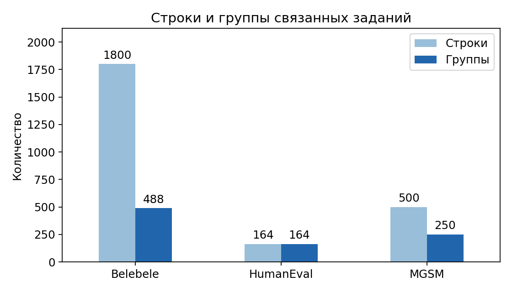
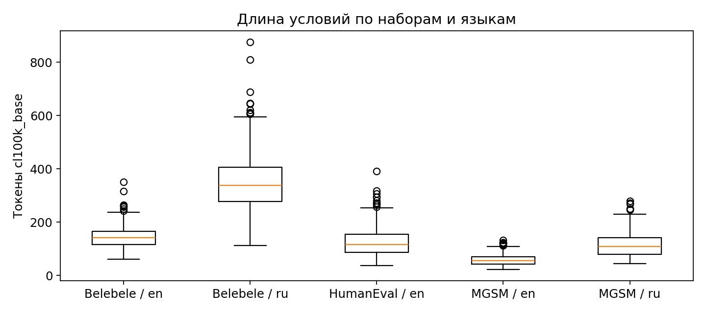
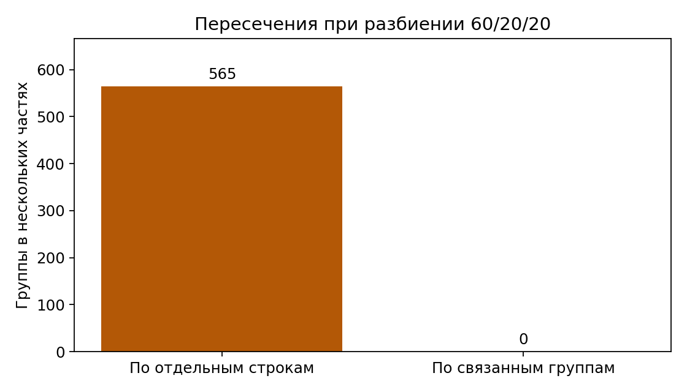

# EDA для Smart LLM Router

Открытый корпус нужен для проверки покрытия доменов и языков, пригодности эталонов, длины запросов и зависимостей между заданиями. Единица наблюдения — задание на одном языке. Состав корпуса определяет, какие диагностики возможны и какие данные понадобятся для сравнения стратегий.

## 1. Источники и покрытие

| Источник | Задания на английском | Задания на русском | Формат и содержание |
| --- | ---: | ---: | --- |
| MGSM | 250 | 250 | TSV, школьные задачи с числовым ответом |
| Belebele | 900 | 900 | JSONL, вопросы к текстам с четырьмя вариантами ответа |
| HumanEval | 164 | 0 | JSONL.gz, условия на Python с эталонной функцией и тестами |
| **Всего** | **1 314** | **1 150** | **2 464 строки** |

Загружены полные файлы соответствующих языков, около 0,56 МБ в сжатом виде. Ревизии, размеры и SHA-256 перечислены в [источниках](../data/sources.lock.json). Данные и лицензии описаны в [data/README.md](../data/README.md).

Покрыты пять из шести целевых групп. Belebele составляет 73,1% строк и проверяет только понимание текста. Среднее по всем строкам будет преимущественно отражать этот навык. Для проверки MVP нужны новые задачи Python на русском и свободные общие запросы на обоих языках. Шестисрезовое среднее можно посчитать после появления русского Python.

В корпусе 1 150 пар переводов и 902 группы связанных заданий. В Belebele 900 вопросов приходятся на 488 текстов. В MGSM группы соответствуют 250 оригинальным задачам, в HumanEval — 164 заданиям. При разбиении и расчёте доверительных интервалов группу сохраняем целиком вместе с обоими языками. Семейства близких по смыслу новых заданий проверяет куратор до разделения корпуса.

## 2. Качество условий и эталонов

| Проверка | Результат | Использование |
| --- | ---: | --- |
| Пропуски обязательных частей условия или эталона | 0 | Повторять при смене снимка |
| Повторяющиеся `task_id` и нормализованные полные условия | 0 | Объединять связанные задания до разбиения |
| Эталоны с некорректным форматом | 0 | Проверяются число, индекс ответа и структура эталонов Python |
| Пары переводов с разными эталонами | 0 из 1 150 | Сверка подтверждает совпадение эталонов |
| Корректные разделители тысяч в MGSM | 8 строк в 4 парах | Например, `2,125` даёт `2125`. Некорректная запись `1,2` отклоняется |
| Повторяющиеся варианты в Belebele | 4 строки в 2 парах | В двух строках продублирован правильный вариант, в двух — отвлекающий. Все четыре помечены для ручной проверки |
| Условия, изменённые авторами MGSM-Rev2 | 22 английских и 32 русских | 32 пары затронуты хотя бы в одном языке. Пересчитать будущие метрики с этой группой и без неё |

Список изменений MGSM-Rev2 сопоставлен по номеру оригинальной строки. Авторы исправляли ошибки, двусмысленности и формулировки. Эталоны языковых пар могут совпадать при различном смысле условий, поэтому проверка ответов требует отдельной проверки переводов. Для очищенной диагностики доступны 2 460 заданий после исключения четырёх строк Belebele. Для проверки чувствительности по MGSM исключаются оба языка каждой из 32 затронутых пар, остаётся 2 396 строк. Графики ниже описывают исходный снимок. [Список изменений MGSM-Rev2](https://github.com/google-research-datasets/MGSM-Rev2/blob/5f091edeae66ebc605ac4f98dca07a6c345f0060/MGSM-Rev2/replaced_questions.json) · [Разбор качества условий](https://arxiv.org/html/2511.05162v2#S5.SS2)

В 164 заданиях HumanEval синтаксически корректны эталонные функции и блоки тестов. В них найдены точки входа и функции `check`. Число узлов `assert` в тестовом блоке варьируется от 1 до 26, медиана равна 7. Проверка статическая. Полноту и результаты тестов предстоит оценить в отдельной среде.

Распределение эталонов одинаково на обоих языках. Позиции 1–4 получили 206, 251, 246 и 197 ответов на язык. Выбор только позиции 2 дал бы 27,9%, равномерный выбор — ожидаемые 25%. При оценке моделей полезно отдельно проверить ответ без исходного текста и повторить диагностику с переставленными вариантами и обновлённым эталоном.

## 3. Длина условий

Используется `cl100k_base` из tiktoken 0.12.0. В длину входят текст, вопрос и варианты Belebele, условие MGSM или исходное приглашение HumanEval. Системные инструкции, служебное оформление и ответы моделей измеряются отдельно на этапе моделирования.

| Источник и язык | Минимум | Медиана | p95 | Максимум |
| --- | ---: | ---: | ---: | ---: |
| Belebele, английский | 62 | 142 | 206 | 351 |
| Belebele, русский | 113 | 338 | 497 | 876 |
| MGSM, английский | 23 | 55 | 102,1 | 132 |
| MGSM, русский | 44 | 108 | 206,65 | 280 |
| HumanEval, английский | 38 | 117 | 270,1 | 391 |

Максимум на диагностической шкале — 876 токенов. Для проверки ограничения в 4 096 токенов нужны отдельные длинные задания и счётчики полного запроса у выбранных моделей.

Медиана отношения русской длины к английской равна 2,33. По отдельным наборам она составляет 2,40 в Belebele и 1,95 в MGSM. Парный расчёт сравнивает переводы одного задания. Для оценки расходов на каждом языке понадобятся счётчики и тарифы конкретного провайдера. Вход во всём снимке содержит 506 219 токенов на этой диагностической шкале.

## 4. Зависимости при разбиении

Хеш с фиксированным seed назначает части с вероятностями 60/20/20. При назначении по строкам в несколько частей попали 565 групп, содержащих 1 852 строки. Из 482 условно тестовых заданий у 427 есть связанное задание в другой части. При назначении по группам пересечений нет.

| Источник | Тестовые строки со связью при разбиении по строкам | Тестовые строки со связью при разбиении по группам |
| --- | ---: | ---: |
| Belebele | 333 из 349 | 0 из 400 |
| MGSM | 94 из 110 | 0 из 88 |
| HumanEval | 0 из 23 | 0 из 23 |

Разные знаменатели следуют из назначения групп целиком. Размеры частей сохранены в [таблице разбиений](tables/illustrative_splits.csv). Это диагностика утечки. Все три публичных набора используются как внешний материал, а пороги и правила маршрутизатора настраиваются на новом корпусе. Belebele предназначен авторами для тестирования. [Назначение Belebele](https://github.com/facebookresearch/belebele#training-set)

## 5. Решения для следующего этапа

| Проблема | Решение |
| --- | --- |
| Русский Python отсутствует, свободные общие ответы не представлены | Собрать новые задачи, скрытые тесты и проверенные рубрики. Начать с 200 заданий на каждый доменно-языковой срез разработки |
| Зависимые переводы и общие тексты | Разбивать по семействам, проверять близкие дубли между частями и пересэмплировать связанные группы целиком |
| Публичные задания могут встречаться в обучающих данных LLM | Итоговое сравнение провести на новых закрытых заданиях. Объём уточнить по расхождениям стратегий и зависимости групп |
| Бенчмарки содержат короткие запросы, меток сложности нет | Выделить длинные и смешанные тесты, проверить полезность признаков сложности на новых заданиях |
| Тексты могут содержать имена и ссылки | Для новых пользовательских данных проверить разрешение на использование, маскировать секреты и ограничить внешнюю передачу |

План подготовки данных, оценки ответов и пилота находится в [дизайн-документе](../docs/ml_system_design_doc.md#23-этапы-решения-задачи). Требования к объёму закрытого теста и ресурсам разметки приведены в [разделе о подготовке пилота](../docs/ml_system_design_doc.md#33-подготовка-пилота).

## 6. Воспроизведение

[Команды запуска и проверок](../README.md#воспроизведение) заново создают шесть графиков, [сводку JSON](eda_summary.json) и [таблицы](tables). Первая загрузка восстанавливает исходные снимки и словарь токенизатора. Повтор использует проверенный локальный кеш.
